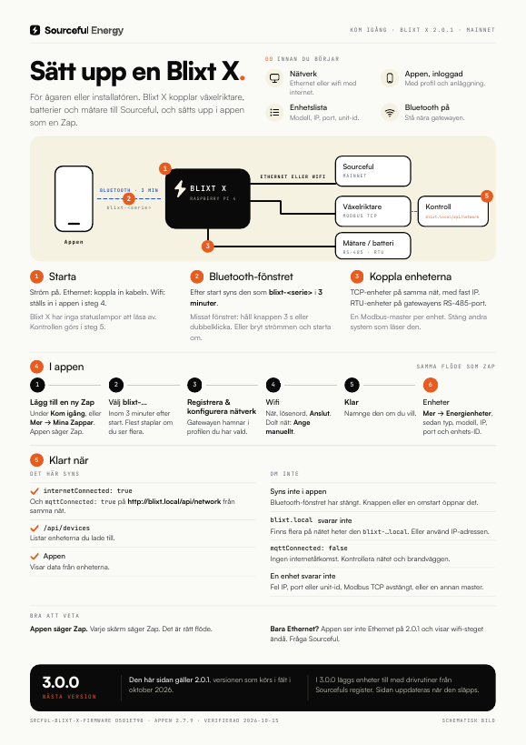

# Kom igång med Sourceful

Kom igång-guider för Sourceful Energys enheter. En guide per produkt, skriven för den som står på plats och ska få enheten att fungera. Varje guide har en one-pager att skriva ut, på svenska och engelska.

English: [README.md](README.md)

| Produkt | Vad den gör | Guide | One-pager |
| --- | --- | --- | --- |
| **Zap** | Läser elmätarens P1/HAN-port och skickar mätardata till Sourceful Energy-appen | [zap/](zap/README.sv.md) | [SV](zap/zap-one-pager-sv.pdf) · [EN](zap/zap-one-pager-en.pdf) |
| **Blixt** | Industri-gateway som styr batterier, växelriktare, mätare och laddboxar på kommersiella och industriella anläggningar | [blixt/](blixt/README.sv.md) | [SV](blixt/blixt-one-pager-sv.pdf) · [EN](blixt/blixt-one-pager-en.pdf) |
| **Blixt X** | Sourcefuls gateway-programvara på en gateway byggd på Raspberry Pi 4, som sätts upp i appen som en Zap | [blixt-x/](blixt-x/README.sv.md) | [SV](blixt-x/blixt-x-one-pager-sv.pdf) · [EN](blixt-x/blixt-x-one-pager-en.pdf) |

| | | |
| --- | --- | --- |
|  |  |  |

## Så håller vi guiderna bra

Guiderna ska vara **korrekta, konkreta och lätta att läsa**. Varje guide säger överst vad den gäller och när den senast kontrollerades mot sina källor, och listar källorna längst ner. Där källorna säger emot varandra står det under **Öppna frågor** i stället för att vi gissar. Reglerna finns i [CONTRIBUTING.md](CONTRIBUTING.md), och CI kontrollerar dem vid varje ändring.

Hittar du ett steg som är fel? Öppna en issue eller en pull request. Ett fel i en guide är ett fel på plats.

## Mer hjälp

- Supportartiklar: [support.sourceful.energy](https://support.sourceful.energy/sv)
- Den gamla Energy Gateway-guiden (2024) finns kvar under taggen [`egw-2024`](https://github.com/srcfl/getting-started/tree/egw-2024).
