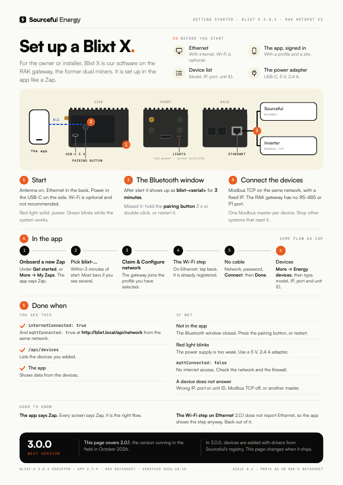

# Blixt X: getting started

> **Applies to:** Blixt X gateway software 2.0.1 (the release running in the field, October 2026) on the RAK Hotspot V2, the Sourceful Energy app 2.7.9 on mainnet
> **Last verified:** 2026-10-15, against `srcful-blixt-x-firmware` at d501e798 (2.0.1) and `srcful-flutter-app` at 9800165 (2.7.9)
> **For:** the owner or installer setting up a Blixt X

Blixt X is Sourceful's gateway software on the RAK Hotspot V2, the gateway Sourceful sold as a dual miner (RAK's "Sourceful ENERGY edition"). Like a Zap, it connects inverters, batteries and EV chargers on the network to Sourceful over the internet. The app sets it up with the Zap flow, and every screen in that flow says "Zap".

Blixt X is not the same product as [Blixt](../blixt/README.md), the industrial gateway for commercial sites.

**Going on site?** Print the one-pager: [English](blixt-x-one-pager-en.pdf) · [Svenska](blixt-x-one-pager-sv.pdf). Svenska: [README.sv.md](README.sv.md).

## The gateway

A black aluminium box with cooling fins on top, 92 × 68 × 57 mm.

| Side | What is there |
| --- | --- |
| Long side | **USB-C** power (5 V, 2.4 A) and the round **pairing button** |
| Front | The **antenna** connector (RP-SMA), the TF card slot, and two **lights**: red and green |
| Back | **Gigabit Ethernet** |

There is no RS-485, P1 or other serial port.

## Before you start

- [ ] **Network:** Ethernet with internet access. Wi-Fi works but is optional and not recommended.
- [ ] **The power adapter:** USB-C, 5 V, 2.4 A, like the one that came with the gateway.
- [ ] **The Sourceful Energy app**, signed in, with a profile and a site.
- [ ] **Bluetooth on** on the phone.
- [ ] **A device list:** model, IP address, port and unit ID for every inverter, battery and meter.

## 1. Start

1. Screw the antenna onto the front. RAK advises against powering the gateway without it.
2. Plug the Ethernet cable into the back. Use Wi-Fi only if there is no cable; you would set it in the app in step 4.
3. Plug the power adapter into the USB-C port on the long side.

- **Red light, solid:** the gateway has power.
- **Green light, blinking:** the system is working, for example while it starts.

The lights do not show whether the gateway is online. You check that in step 6.

## 2. The Bluetooth window

After it starts, the gateway shows up over Bluetooth as **blixt-&lt;serial&gt;** for **3 minutes**. The app only finds it during that window.

Missed it:

- Hold the **pairing button** on the long side for 3 seconds, or double-click it. That opens 3 more minutes.
- Or cut the power and start the gateway again.

## 3. Connect the devices

Devices connect over the network: Modbus TCP on the same network as the gateway, with a fixed IP address or a DHCP reservation. The RAK gateway has no RS-485 or P1 port, so serial devices and the electricity meter's P1 port cannot be connected to it. Use a Zap for the meter.

A device can have only one Modbus master. Stop other systems that read the same device.

## 4. In the app

The flow is the Zap flow. Where the app says "Zap", it means the Blixt X.

1. Open Sourceful Energy and sign in. No profile or site yet: tap **Create new profile** or **Create new site** first.
2. Tap **Onboard a new Zap** under **Get started**. Or go to **More → My Zaps → Add a new Zap**.
3. Pick **blixt-…** in the list, within 3 minutes of the gateway starting. If you see several, pick the one with the most signal bars.
4. Tap **Claim & Configure network**. The gateway joins the profile you have selected.
5. **WiFi Setup** opens. On Ethernet, tap back: the gateway is already registered, and Wi-Fi is not needed. Only without a cable: pick the network, enter the password and tap **Connect** (hidden network: **Enter manually**), then name the gateway and tap **Done**.

> **Why the Wi-Fi step shows up on Ethernet:** on 2.0.1 the gateway does not report its Ethernet connection to the app, so the app never offers **Skip WiFi setup**. The registration already happened when you tapped **Claim & Configure network**.

## 5. Add the devices in the app

1. Go to **More**, open the site, then **Energy devices → Add Energy Device**.
2. With more than one gateway: **Select Gateway**.
3. Tap **Onboard New Device**, then the type and the model.
4. Enter **Host Address**, **Port** and **Unit ID**, then **Continue**.
5. Tap **Connect Device**, then **Enable Resources** and **Done**.

## 6. Done when

From a laptop on the same network:

- `http://blixt.local/api/network` shows `"internetConnected": true` and `"mqttConnected": true`.
- `http://blixt.local/api/devices` lists the devices you added.
- The app shows data from the devices.

If another device already uses the name, the gateway calls itself `blixt-<suffix>.local` instead. You can always use its IP address.

## Troubleshooting

| What you see | Probably | Do this |
| --- | --- | --- |
| The app does not find the gateway | The 3-minute Bluetooth window has closed | Hold the pairing button 3 s or double-click it, or restart the gateway. Stand close. |
| The red light blinks | The power supply is too weak | Use a 5 V, 2.4 A USB-C adapter. |
| `blixt.local` does not answer | Several gateways on the network, or the laptop is on another network | Look for `blixt-…local`, or use the gateway's IP address from the router. |
| `"mqttConnected": false` | No internet access | Check the network, the cable or Wi-Fi, and the firewall. |
| A device does not answer | Wrong IP, port or unit ID, Modbus TCP off in the device, or another Modbus master | Check the settings in the device and in the app. Stop the other master. |

## What changes in 3.0.0

Blixt X 3.0.0 is on `main` but not in the field yet. In 3.0.0, devices are added with a driver and version from Sourceful's driver registry instead of a built-in profile, and the gateway reports Ethernet to the app. This guide is updated when 3.0.0 ships.

## Open questions

- When does 3.0.0 reach the field? The app 2.7.9 adds devices with a profile, which 3.0.0 refuses, so the app needs an update first.
- The name: the firmware README calls the gateway "Blixt", the same name as the commercial Blixt.

## Sources

- RAK Hotspot V2: [datasheet](https://docs.rakwireless.com/product-categories/wisgate/rak-hotspot-v2/datasheet) (dimensions, interfaces, USB-C 5 V / 2.4 A, lights), [troubleshooting](https://docs.rakwireless.com/product-categories/wisgate/rak-hotspot-v2/troubleshooting) (what the lights mean), [installation guide](https://docs.rakwireless.com/product-categories/wisgate/rak-hotspot-v2/installation-guide) (antenna before power)

The repositories below are internal. Paths refer to the commits named at the top.

- `srcfl/srcful-blixt-x-firmware` at d501e798 (2.0.1): `bluetooth/ble_service.py` and `bluetooth/gpioButton.py` (name, 3-minute window, button), `server/network/network_utils.py` (`blixt.local`), `server/core/api_server.py` (`/api/network`), `server/core/device_factory.py` (RS-485 default), `server/app/app.py` (version 2.0.1)
- The field fleet's target release, checked read-only on 2026-10-15: built 2026-03-26, matching d501e798 (2.0.1). No newer release is pinned.
- `srcfl/srcful-blixt-x-firmware` on `main` (156134dd): `api.md`, `server/core/serial_ports.py`, `server/api/system.py` (what changes in 3.0.0)
- `srcfl/srcful-flutter-app` at 9800165 (app 2.7.9): `lib/screens/zap_onboard_screen.dart` (the scan finds `blixt-…`; the gateway is claimed before the Wi-Fi screen opens), `lib/components/src_app_shell.dart` (back on nested screens), `zap_wifi_setup_screen.dart` and `lib/services/zap_ble_client.dart` (Ethernet detection), `lib/services/zap_proxy_client.dart` (devices added with a profile)
- The one-pager is built from [onepagers/blixt_x.py](../onepagers/blixt_x.py)
