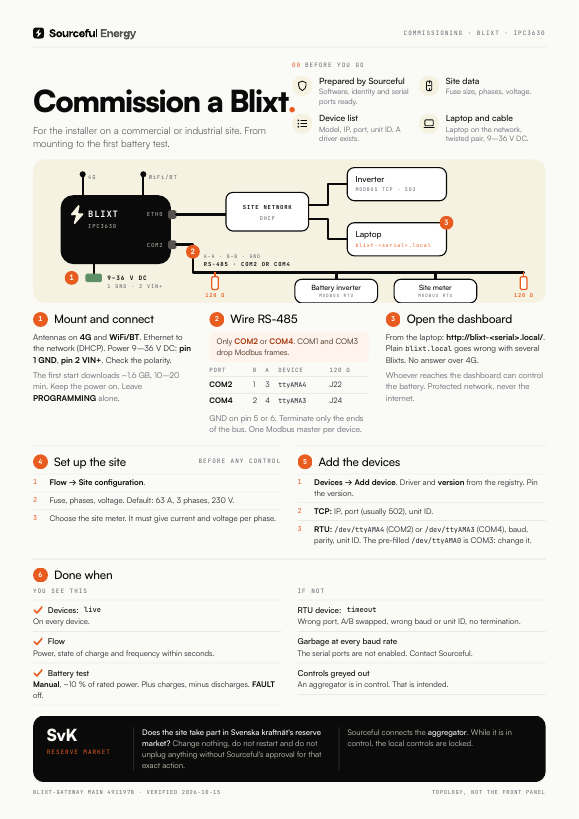

# Blixt: getting started

> **Applies to:** the Blixt gateway on EDATEC ED-IPC3630 (Pi CM5), dashboard 3.x. ED-IPC1100 where noted.
> **Last verified:** 2026-10-15, against `blixt-gateway` on `main` (491197b)
> **For:** the installer commissioning a Blixt on a site

Blixt is an industrial PC that controls batteries, hybrid inverters, meters and EV chargers on commercial and industrial sites. It reads and controls the devices over Modbus RTU or TCP, keeps the site within its fuse and export limits, and sends measurements to Sourceful. Everything is set up in the Blixt dashboard on the site network.

**Going on site?** Print the one-pager: [English](blixt-one-pager-en.pdf) · [Svenska](blixt-one-pager-sv.pdf). Svenska: [README.sv.md](README.sv.md).

## What Sourceful does before you go

You should receive a prepared unit. Ask Sourceful before you leave if any of this is unclear:

- The unit has the right software and is connected to the right Sourceful environment.
- The unit's identity is registered with Sourceful. Without it, no measurements arrive.
- On the IPC3630: the serial ports are enabled for the unit.
- You know which inverters, batteries and meters to connect, and there is a driver for each model.

> **Warning:** If the site takes part in Svenska kraftnät's reserve market: change nothing in the dashboard, do not restart and do not unplug anything without Sourceful's approval for that exact action.

## Bring

- [ ] The Blixt with its antennas (4G and WiFi/BT)
- [ ] A 9–36 V DC supply (IPC3630)
- [ ] An Ethernet cable to the site network, with DHCP
- [ ] Twisted-pair cable for RS-485 if any device connects by serial
- [ ] Model, IP address, port and unit ID for every inverter, battery and meter
- [ ] The site's fuse size, number of phases and voltage
- [ ] A laptop on the same network as the Blixt

## 1. Mount and connect

1. Screw on the antennas: **4G** and **WiFi/BT**.
2. Connect Ethernet to the site network. Blixt gets its address over DHCP. 4G is the backup link.
3. Connect power. IPC3630: 2-pin terminal, **pin 1 = GND**, **pin 2 = VIN+**, 9–36 V DC. Check the polarity before you switch on.

Do not use the **PROGRAMMING** port. It is only for imaging the unit.

The unit is online after about a minute. The first time, it downloads its software, about 1.6 GB. That takes 10–20 minutes, longer over 4G. Do not cut the power meanwhile.

## 2. Wire RS-485 (IPC3630)

> **Warning:** Use only **COM2** or **COM4** for Modbus. COM1 and COM3 drop short Modbus frames.

| Port | B | A | GND | Device in the dashboard | Termination |
| --- | --- | --- | --- | --- | --- |
| COM2 | pin 1 | pin 3 | pin 5 or 6 | `/dev/ttyAMA4` | jumper J22 |
| COM4 | pin 2 | pin 4 | pin 5 or 6 | `/dev/ttyAMA3` | jumper J24 |

1. Connect A to A, B to B and GND to GND. The ports are isolated, so GND must be connected.
2. Terminate only the two ends of the bus with 120 Ω. If the Blixt is at one end, fit the jumper for its port. The jumpers are open from the factory.
3. A device can have only one Modbus master. If another system needs to read the same device, use **Gateway → Modbus proxy** in the dashboard instead of a second master.

## 3. Open the dashboard

From a laptop on the same network: `http://blixt-<serial>.local/`.

Use the serial in the address. Plain `blixt.local` goes wrong when there is more than one Blixt on the network. The dashboard does not answer on the 4G address.

> **Warning:** Whoever reaches the dashboard can control the battery. Keep the Blixt on a protected network, and never open it to the internet.

## 4. Set up the site

Do this **before** anything is controlled.

1. Go to **Flow → Site configuration**.
2. Enter the fuse size, the number of phases and the voltage. The default is 63 A, 3 phases, 230 V.
3. Choose the site meter. It must report current and voltage on every phase. If it does not, the batteries are limited and a banner says why.

## 5. Add the devices

For each inverter, battery and meter:

1. Go to **Devices** and choose **Add device**.
2. Pick the driver and the **version** from the list. The list comes from Sourceful's driver registry. If a new version is missing, press **↻ Refresh**.
3. Always pin a version. A device without a pinned version follows the latest one and can change behaviour without anyone noticing.
4. Choose the connection:
   - **TCP:** IP address, port (usually 502) and unit ID.
   - **RTU:** serial port (`/dev/ttyAMA4` for COM2, `/dev/ttyAMA3` for COM4), baud rate, parity and unit ID.

> **Warning:** The RTU form is pre-filled with `/dev/ttyAMA0`. That is COM3. Change it to COM2 or COM4.

## 6. Done when

- **Devices:** every device shows `live`. `timeout`, `stale` or `no data` means it is not answering.
- **Flow:** power, state of charge (SoC) and frequency show within a few seconds.
- **Battery test:** in **Manual** mode, run about 10 % of the battery's rated power. Positive power charges, negative discharges. The deviation should stay close to 0 and **FAULT** should be off.

Sourceful connects the Blixt to an aggregator, not the installer. While an aggregator is in control, the local controls are locked.

## Troubleshooting

| What you see | Probably | Do this |
| --- | --- | --- |
| An RTU device shows `timeout` or `no data` | Wrong port (COM1, COM3 or the pre-filled `/dev/ttyAMA0`), A and B swapped, wrong baud rate or unit ID, no termination | Use COM2 or COM4. Check A/B, the settings and the termination. |
| The same garbage at every baud rate, on IPC3630 | The serial ports are not enabled for the unit | Contact Sourceful. |
| Serial errors after you changed a device's port and restarted control | The old port is still held open | Contact Sourceful for a restart of the control service. |
| The dashboard does not open | Wrong address, or several Blixts with the same name | Use `blixt-<serial>.local` from a laptop on the same network. |
| The controls are greyed out | An aggregator is in control | That is intended. Contact Sourceful if you need local control. |
| The battery charges but does not discharge | The inverter's export protection (anti-backflow) is on | Check that setting in the inverter. |
| Power settles just below the setpoint | The fuse limit is capping it | Check **Site configuration**. |
| The unit never shows up at Sourceful | Antenna missing (IPC1100), the first update is still running, or the identity is not registered | Check the antenna, wait 20 minutes, then contact Sourceful. |

## Open questions

- Which hardware is the product for new installations, IPC3630 or IPC1100? This guide describes the IPC3630 because it is the best documented.
- IPC1100: the power range, the RS-485 terminal and termination are not documented.
- Who registers the unit's identity, and is there a step for the installer?
- Is the serial printed on the unit the same one used in `blixt-<serial>.local`?
- The existing quick start in `blixt-gateway` says Blixt runs on USB-C 5 V. That matches neither model.

## Sources

The `srcfl/blixt-gateway` repository is internal. Paths refer to `main` at 491197b.

- `README.md`: what Blixt is, provisioning, first boot, drivers from the registry
- `docs/specs/ipc-3600-specs.md`: power, ports, COM ports, termination, isolation
- `docs/gateway/DASHBOARD-ACCESS.md`: dashboard address and network protection
- `services/dashboard/README.md`: device states, aggregator lock, driver choice and version pinning
- `docs/specs/site-limits.md`: fuse, phases and the site-meter requirement
- `docs/gateway/Sourceful-Gateway-Battery-and-SvK-Tests.html`: the battery test in Manual mode
- `services/dashboard/web/src/.../DeviceForm.tsx`: the pre-filled `/dev/ttyAMA0` and connection types
