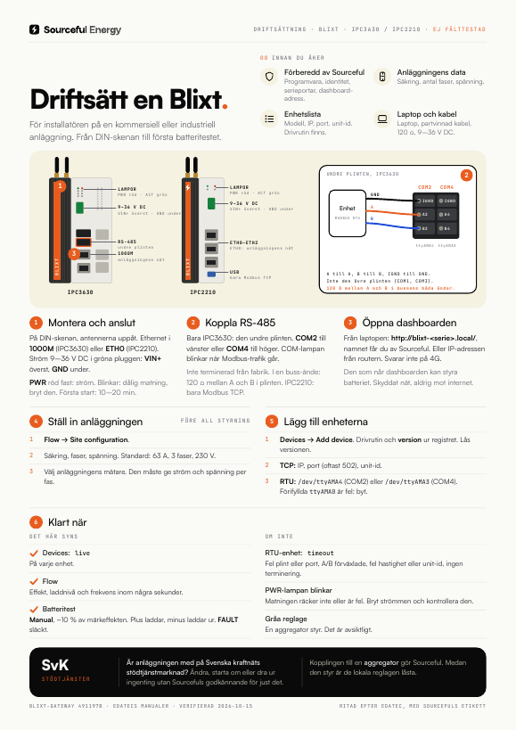
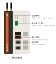
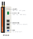

# Blixt: kom igång

> **Gäller:** Blixt-gatewayen på EDATEC ED-IPC3630 (IPC3600-serien) eller ED-IPC2210, dashboard 3.x  
> **Senast verifierad:** 2026-10-15, mot `blixt-gateway` på `main` (491197b) och EDATECs manualer  
> **För:** installatören som driftsätter en Blixt på en anläggning  
> **Fälttest:** inte gjort än. Checklista: [CHECKLIST.md](CHECKLIST.md)

Blixt är en industri-gateway som styr batterier, hybridväxelriktare, mätare och laddboxar på kommersiella och industriella anläggningar. Den läser och styr enheterna över Modbus RTU eller TCP, håller anläggningens säkring och exportgräns, och skickar mätvärden till Sourceful. Allt ställs in i Blixts lokala dashboard.

**Ska du ut på plats?** Skriv ut one-pagern: [Svenska](blixt-one-pager-sv.pdf) · [English](blixt-one-pager-en.pdf). English: [README.md](README.md).

## De två modellerna

| IPC3630 | IPC2210 |
| --- | --- |
|  |  |

Sourceful installerar båda. De sitter upprätt på en DIN-skena, med antennerna upptill och alla kontakter på den smala framsidan.

| | IPC3630 | IPC2210 |
| --- | --- | --- |
| Storlek (front × höjd × djup) | 55 × 143 × 100 mm | 34 × 143 × 100 mm |
| Ström | 9–36 V DC, grön 2-polig plugg, **VIN+** överst, **GND** under | Samma |
| Ethernet | **1000M** (anläggningens nät) och **100M** | **ETH0** (anläggningens nät), **ETH1**, **ETH2**, alla gigabit |
| RS-485 | **COM2** och **COM4** på den undre 6-poliga plinten | Ingen |
| Lampor | **PWR** röd, **ACT** grön, **COM1–COM4**, plus lampor för in- och utgångar som Blixt inte använder | **PWR** röd, **ACT** grön |
| Antenner | WiFi/BT och 4G upptill, om enheten är beställd med dem | Samma |

IPC3630:s front uppifrån och ned: lamporna, strömpluggen, den övre serieplinten (COM1 och COM3), den undre serieplinten (COM2 och COM4), sedan Ethernet-portarna 1000M och 100M. Plintarna till höger om dem (ingångar, CAN, utgångar) används inte av Blixt.

## Det här gör Sourceful innan du åker

Du ska få en enhet som är förberedd. Fråga Sourceful om något av det här är oklart innan du åker:

- Enheten har rätt programvara och är kopplad till rätt miljö hos Sourceful.
- Enhetens identitet är registrerad hos Sourceful. Annars kommer inga mätvärden fram. Det gör Sourceful, det finns inget steg för installatören.
- På IPC3630: serieportarna är aktiverade för enheten.
- Du vet vilka växelriktare, batterier och mätare som ska kopplas in, och att det finns en drivrutin för varje modell.
- Du har enhetens dashboard-adress, `http://blixt-<serienummer>.local/`.

> **Varning:** Är anläggningen med på Svenska kraftnäts stödtjänstmarknad: ändra ingenting i dashboarden, starta inte om och dra inte ur något utan att Sourceful har godkänt just det.

## Ta med

- [ ] Blixt, med antenner om den har det
- [ ] Strömförsörjning 9–36 V DC
- [ ] Ethernetkabel till anläggningens nät, med DHCP
- [ ] Partvinnad kabel för RS-485 om någon enhet ska kopplas seriellt (bara IPC3630), och ett 120 Ω-motstånd om Blixt ska sitta i ena änden av bussen
- [ ] Modell, IP-adress, port och unit-id för varje växelriktare, batteri och mätare
- [ ] Säkringsstorlek, antal faser och spänning för anläggningen
- [ ] En laptop på samma nät som Blixt

## 1. Montera och anslut

1. Snäpp fast Blixt på DIN-skenan, upprätt, med antennerna uppåt. Skruva fast antennerna: **WiFi/BT** och **4G**.
2. Anslut Ethernet till anläggningens nät. IPC3630: porten **1000M**. IPC2210: **ETH0**. Blixt hämtar adress via DHCP. 4G är reservförbindelse.
3. Anslut strömmen i den gröna pluggen: **VIN+** överst, **GND** under, 9–36 V DC. Kontrollera polariteten innan du slår på.

Använd inte **PROGRAMMING**-porten (Micro-USB, under DIN-fästet). Den är bara till för att avbilda enheten.

- **PWR röd, fast:** enheten har ström. **PWR blinkar:** matningen är dålig. Bryt strömmen och kontrollera den.
- **ACT grön:** blinkar när lagringen arbetar.

Enheten är uppkopplad efter ungefär en minut. Första gången hämtar den sin programvara, ungefär 1,6 GB. Det tar 10–20 minuter, längre på 4G. Dra inte ur strömmen under tiden.

## 2. Koppla RS-485 (bara IPC3630)

Använd den **undre** serieplinten. Den vänstra kolumnen är COM2, den högra COM4. Etiketterna står tryckta bredvid plinten.

| Port | Etiketter uppifrån och ned | Enhet i dashboarden |
| --- | --- | --- |
| COM2 | **IGND**, **A2**, **B2** (vänster kolumn) | `/dev/ttyAMA4` |
| COM4 | **IGND**, **A4**, **B4** (höger kolumn) | `/dev/ttyAMA3` |

1. Koppla A till A, B till B och IGND till enhetens GND. Portarna är isolerade, så GND ska med.
2. Terminera bara bussens två ändar med 120 Ω. Blixt är inte terminerad från fabrik. Sitter den i ena änden av bussen: sätt ett 120 Ω-motstånd mellan A och B i den undre plinten, A2–B2 för COM2, A4–B4 för COM4. Öppna inte höljet.
3. En enhet kan bara ha en Modbus-master. Behöver något annat system läsa samma enhet: använd **Gateway → Modbus proxy** i dashboarden i stället för en andra master.

Lampan **COM2** eller **COM4** blinkar när det går trafik på linjen. Det är en snabb kontroll av kablaget.

> **Varning:** Använd inte den övre plinten (COM1 och COM3) för Modbus. De är inte verifierade för det, och på vissa varianter är de RS-232.

IPC2210 har ingen serieport. På IPC2210 kopplas enheter bara över nätet (Modbus TCP).

## 3. Öppna dashboarden

Från en laptop på samma nät: `http://blixt-<serienummer>.local/`. Sourceful ger dig det exakta namnet innan du åker; det står inte på enheten. Du kan också använda Blixtens IP-adress från anläggningens router.

Bara `blixt.local` blir fel när det finns fler än en Blixt på nätet. Dashboarden svarar inte på 4G-adressen.

> **Varning:** Den som når dashboarden kan styra batteriet. Ha Blixt på ett skyddat nät, och öppna den aldrig mot internet.

## 4. Ställ in anläggningen

Gör det här **innan** något styrs.

1. Gå till **Flow → Site configuration**.
2. Ange säkringsstorlek, antal faser och spänning. Standardvärdet är 63 A, 3 faser, 230 V.
3. Välj anläggningens mätare. Den måste rapportera ström och spänning på varje fas. Gör den inte det begränsas batterierna, och en banderoll visar varför.

## 5. Lägg till enheterna

För varje växelriktare, batteri och mätare:

1. Gå till **Devices** och välj **Add device**.
2. Välj drivrutin och **version** i listan. Listan kommer från Sourcefuls drivrutinsregister. Syns inte en ny version: tryck **↻ Refresh**.
3. Lås alltid en version. En enhet utan låst version följer senaste versionen och kan ändra beteende utan att någon märker det.
4. Välj anslutning:
   - **TCP:** IP-adress, port (oftast 502) och unit-id.
   - **RTU** (IPC3630): serieport (`/dev/ttyAMA4` för COM2, `/dev/ttyAMA3` för COM4), hastighet, paritet och unit-id.

> **Varning:** I RTU-formuläret är `/dev/ttyAMA0` förifyllt. På IPC3630 är det COM3. Byt till COM2 eller COM4.

## 6. Klart när

- **Devices:** varje enhet visar `live`. `timeout`, `stale` eller `no data` betyder att den inte svarar.
- **Flow:** effekt, laddnivå (SoC) och frekvens syns inom några sekunder.
- **Batteritest:** i **Manual**-läge, kör ungefär 10 % av batteriets märkeffekt. Positiv effekt laddar, negativ laddar ur. Avvikelsen ska ligga nära 0 och **FAULT** ska vara släckt.

Kopplingen till en aggregator görs av Sourceful och inte på plats. Medan en aggregator styr är de lokala reglagen låsta.

## Felsökning

| Det du ser | Troligen | Gör så här |
| --- | --- | --- |
| En RTU-enhet visar `timeout` eller `no data` | Fel plint eller port (den övre plinten, eller förifyllda `/dev/ttyAMA0`), A och B förväxlade, fel hastighet eller unit-id, ingen terminering | Använd COM2 eller COM4 på den undre plinten. Kontrollera A/B, inställningarna och termineringen. |
| COM-lampan blinkar inte | Ingen trafik på linjen | Kontrollera att enheten har samma port i dashboarden som kabeln sitter i. |
| Samma skräpdata oavsett hastighet | Serieportarna är inte aktiverade för enheten | Kontakta Sourceful. |
| Fel på serieporten efter att du bytt port och startat om styrningen | Den gamla porten hänger kvar | Kontakta Sourceful för en omstart av styrtjänsten. |
| PWR blinkar | Matningen räcker inte eller är fel | Bryt strömmen och kontrollera matningen: 9–36 V DC, VIN+ överst. |
| Dashboarden öppnas inte | Fel adress, eller flera Blixt med samma namn | Använd `blixt-<serienummer>.local` från en laptop på samma nät. |
| Reglagen är gråa | En aggregator styr | Det är avsiktligt. Kontakta Sourceful om du behöver styra lokalt. |
| Batteriet laddar men laddar inte ur | Växelriktarens skydd mot export (anti-backflow) är på | Kontrollera inställningen i växelriktaren. |
| Effekten stannar strax under börvärdet | Säkringsgränsen begränsar | Kontrollera **Site configuration**. |
| Enheten dyker aldrig upp hos Sourceful | Första uppdateringen pågår, eller identiteten är inte registrerad | Vänta 20 minuter, kontakta sedan Sourceful. |

## Källor

- EDATEC: [IPC3630 användarmanual](https://edatec.cn/docs/ipc3630/um/1-hardware/) och [datablad](https://edatec.cn/docs/ipc3630/ds/) (frontpanel, strömplugg, serieplintar och stift, termineringsbyglar, lampor, portar), [IPC2200 användarmanual](https://edatec.cn/docs/ipc2200/um/1-hardware/) och [datablad](https://edatec.cn/docs/ipc2200/ds/) (IPC2210:s frontpanel, ström, Ethernet)

Repot `srcfl/blixt-gateway` är internt. Sökvägarna gäller `main` vid 491197b.

- David (2026-10-15): båda modellerna är produkter, IPC2210 på ETH0 och bara Modbus TCP, installatören terminerar vid plinten
- `README.md`: vad Blixt är, provisionering och registrering av identiteten (görs av Sourceful med en admin-nyckel), första uppstart, drivrutiner från registret
- `docs/specs/ipc-3600-specs.md`: COM-portarna och deras Linux-enheter, vilka portar som används för Modbus, lamporna under balenaOS
- `docs/gateway/DASHBOARD-ACCESS.md`: adress till dashboarden och nätskydd
- `services/dashboard/README.md`: Devices-statusar, aggregatorlås, drivrutinsval och versionslåsning
- `docs/specs/site-limits.md`: säkring, faser och krav på anläggningens mätare
- `docs/gateway/Sourceful-Gateway-Battery-and-SvK-Tests.html`: batteritestet i Manual-läge
- `services/dashboard/web/src/.../DeviceForm.tsx`: förifyllda `/dev/ttyAMA0` och anslutningstyper
- Flottor och enheter, listade med bara läsning 2026-10-15
- One-pagern byggs från [onepagers/blixt.py](../onepagers/blixt.py)
