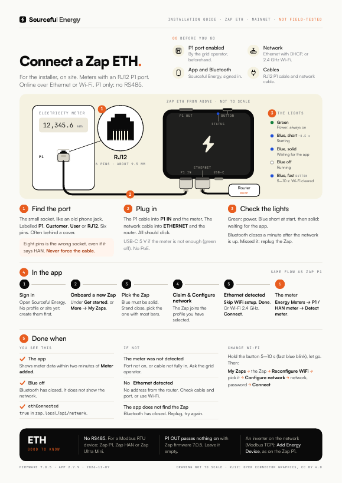
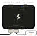

# Zap ETH: getting started

> **Applies to:** Zap ETH (for meters with an RJ12 P1 port), firmware 7.0.5 or later, the Sourceful Energy app 2.7.9 on mainnet  
> **Last verified:** 2026-11-07, against the sources at the bottom  
> **For:** the installer on site  
> **Field test:** not done yet. Checklist: [CHECKLIST.md](CHECKLIST.md)

The Zap ETH reads the electricity meter's P1 port (RJ12), like the [Zap P1](../zap/README.md), and sends the data to the Sourceful Energy app over **Ethernet or Wi-Fi**. It reads the meter only: it has no RS485 terminal.

Does the meter only have an RJ45 HAN port? Then you need the [Zap HAN](../zap-han/README.md). A meter or inverter on RS485: use the [Zap P1](../zap/README.md#over-rs485), the [Zap Ultra Mini](../zap-ultra-mini/README.md#rs485) or the [Zap Ultra X2](../zap-ultra-x2/README.md#rs485) with an RS485 module.

**Going on site?** Print the one-pager: [English](zap-eth-one-pager-en.pdf) · [Svenska](zap-eth-one-pager-sv.pdf). Svenska: [README.sv.md](README.sv.md).

## The Zap ETH

The drawing shows the order of the ports, not the real proportions.

| IN side, from the left | OUT side, from the left |
| --- | --- |
| **P1 IN** (RJ12): the cable to the meter | The **button** |
| **Ethernet** (RJ45) | The blue **status light** |
| **USB-C**: power, when needed | **P1 OUT** (RJ12): passes nothing on with Zap firmware 7.0.5 |
| The green **power light**. On newer units it sits inside P1 IN. | |

## Before you go

- [ ] **The P1 port is enabled by the grid operator.** Usually on their website, otherwise by phone.
- [ ] **A network:** an Ethernet cable to a router or switch port that hands out addresses (DHCP), or the name and password of a 2.4 GHz Wi-Fi network.
- [ ] **The Sourceful Energy app**, signed in, with a profile and a site. **Bluetooth on** on the phone.
- [ ] **An RJ12 P1 cable** and, for Ethernet, a network cable.
- [ ] **A USB-C charger** (5 V) if the meter is older than P1 version 5.0.

## 1. Find the port on the meter

The small socket, like an old telephone jack: RJ12, six pins. It is labelled **P1**, **Customer**, **User** or **RJ12**, and often sits behind a small cover.

> **Warning:** A wider socket with eight pins (RJ45) is the wrong one, even if it says HAN. Never use an adapter and never force the cable. A meter with only an RJ45 HAN port needs the [Zap HAN](../zap-han/README.md).

## 2. Plug in

1. Push the P1 cable into the Zap's **P1 IN**, on the long side with Ethernet and USB-C, and the other end into the meter's P1 port. Both should click.
2. For Ethernet: a network cable from **Ethernet** to the router or switch. The Zap gets its address by DHCP; there is no setting for a fixed address.

A meter with P1 version 5.0 powers the Zap through the cable. If the green light stays off or blinks, the meter does not give enough power: plug in USB-C (5 V) as well. The Zap cannot take power from the network cable (no PoE).

Leave **P1 OUT** empty: with Zap firmware 7.0.5 it passes no meter data on.

## 3. Check the lights

- **Green, solid:** the Zap has power. It should never blink.
- **Blue** lights for half a second at start, then **blue, solid:** the Zap is waiting for the app over Bluetooth. Go to step 4.

As long as no Wi-Fi is saved, Bluetooth opens at every start. Once the Zap is online, over Ethernet or Wi-Fi, Bluetooth closes after **one minute**. Have the app ready before you plug in the network cable. Missed it? Unplug the Zap (P1 cable and USB-C) and plug it in again.

> **Warning:** Holding the button longer than 10 seconds and letting go is a factory reset: it deletes the Wi-Fi and every device added to the Zap.

## 4. In the app

1. Open Sourceful Energy and sign in. No profile or site yet: create them first.
2. Tap **Onboard a new Zap** under **Get started**. Or go to **More → My Zaps → Add a new Zap**.
3. Stand close to the Zap and pick the one with the most bars.
4. Tap **Claim & Configure network**. The Zap joins the profile you have selected.
5. **WiFi Setup** opens. With the network cable in, **Ethernet detected** appears within about ten seconds: tap **Skip WiFi setup**. The app closes Bluetooth and shows **Connected via Ethernet**. Name the Zap if you like and tap **Done**.
6. Without Ethernet: pick the 2.4 GHz network, enter the password, tap **Connect**, then **Done**, as on the [Zap P1](../zap/README.md#4-in-the-app).

You can also set up Wi-Fi with the cable in, as a backup. With both up, the Zap sends its data over Wi-Fi.

## 5. Add the meter

The Zap does not read the meter until the meter is added in the app.

1. Go to **More**, open the site, then **Energy devices → Add Energy Device**.
2. Tap **Onboard New Device**, then **Energy Meters** and **P1 / HAN meter**.
3. Tap **Detect meter**. **Meter added** appears. Tap **Done**.

Meter data can take up to two minutes to appear.

## 6. Done when

- **The app** shows meter data.
- **Blue** is off: Bluetooth has closed. The light does not show whether the network works.

On a laptop on the same network, `http://zap.local/api/network` shows `"ethConnected": true` for Ethernet, and `"internetConnected": true` and `"mqttConnected": true` once the Zap reaches Sourceful. `http://zap.local/api/devices` lists the meter; its `sn` starts with `p1m-`.

An inverter on the network (Modbus TCP) is added as on the Zap P1: [Add an inverter](../zap/README.md#add-an-inverter).

## Change Wi-Fi

1. Hold the button 5–10 seconds until blue blinks fast, then let go. The Zap forgets the Wi-Fi and restarts with Bluetooth open.
2. In the app: **More → My Zaps**, tap the Zap, then **Reconfigure WiFi**.
3. Tap the Zap in the list, then **Configure network**, pick the network, enter the password and tap **Connect**.

## The lights and the button

| Light | How it looks | Means |
| --- | --- | --- |
| Green | Solid | Power |
| Green | Off or blinking | Not enough power. Plug in USB-C. |
| Blue | On for half a second at start | Starting |
| Blue | Solid | Waiting for the app (Bluetooth open) |
| Blue | Off | Running. It does not show the network: check the app |

| Hold the button | While you hold | When you let go |
| --- | --- | --- |
| 2–5 s | Blue blinks slowly | The Zap restarts |
| 5–10 s | Blue blinks fast | Wi-Fi is cleared, the Zap restarts and waits for the app |
| More than 10 s | Blue is solid | Factory reset: Wi-Fi, connection settings and every added device are deleted |

## Troubleshooting

| What you see | Probably | Do this |
| --- | --- | --- |
| The app does not find the Zap | Bluetooth closed a minute after the Zap went online | Unplug the Zap and plug it in, then scan again within a minute. |
| **Ethernet detected** does not appear | No address from the router (DHCP), or the cable is not in | Check the cable and the router port. Or set up Wi-Fi instead. |
| **The meter was not detected** | The P1 port is not enabled, or the cable is not fully in | Push the cable in at both ends. Ask the grid operator to enable the port. |
| Green off or blinking | Not enough power from the meter | Plug in USB-C (5 V). |
| A device on P1 OUT gets no data | P1 OUT passes nothing on with Zap firmware 7.0.5 | Take it off P1 OUT. |

## Sources

- The hardware vendor's documentation for this board, read 2026-11-07: the ports on both sides and their order, the green power light (always on, never blinking; inside P1 IN from hardware 3.2), the blue status light, power from a P1 version 5.0 meter or USB-C, no PoE
- `srcfl/srcful-zap-x-firmware` at `v7.0.5` (346754de): `components/board/include/boards/zap-eth.h` (one status light, button, P1 input; P1 output pin `-1`, so P1 OUT passes nothing on; no Modbus RTU pins), `components/p1_data_reader/p1_meter.h` (the P1 output uses that pin), `fw_controller/main/main.cpp` (status light on for 500 ms at start; Bluetooth opens without saved Wi-Fi, also with Ethernet), `fw_controller/main/main_loop.cpp` (on while Bluetooth waits; Bluetooth closes 60 s after Wi-Fi or Ethernet is up; button 2/5/10 s), `components/wifi/eth_manager.cpp` (DHCP, no fixed address), `fw_controller/API.md` (`ethConnected`, Wi-Fi preferred when both are up)
- `srcfl/srcful-flutter-app` at `v2.7.9`: `lib/screens/zap_wifi_setup_screen.dart` (**Ethernet detected**, **Skip WiFi setup**, **Connected via Ethernet**), `lib/l10n/app_en_US.arb`; adding the meter as for the [Zap P1](../zap/README.md#sources)
- Sourceful's test rig, 2026-11-07: a Zap ETH on firmware 7.0.5 reads a P1 meter
- The one-pager is built from [onepagers/zap_eth.py](../onepagers/zap_eth.py) and [onepagers/zap_ethernet.py](../onepagers/zap_ethernet.py); the RJ12 jack follows Open Connector Graphics (Wikke Andeweg, CC BY 4.0)
