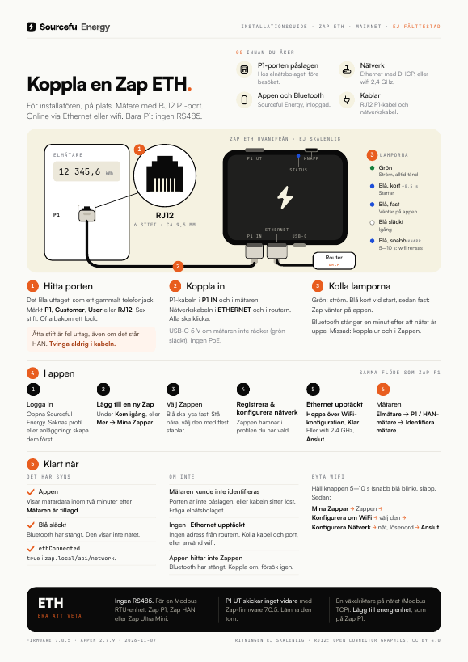
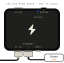

# Zap ETH: kom igång

> **Gäller:** Zap ETH (för mätare med RJ12 P1-port), firmware 7.0.5 eller senare, Sourceful Energy-appen 2.7.9 på mainnet  
> **Senast verifierad:** 2026-11-07, mot källorna längst ner  
> **För:** installatören på plats  
> **Fälttest:** inte gjort än. Checklista: [CHECKLIST.md](CHECKLIST.md)

Zap ETH läser elmätarens P1-port (RJ12), precis som [Zap P1](../zap/README.sv.md), och skickar mätardata till Sourceful Energy-appen via **Ethernet eller wifi**. Den läser bara mätaren: den har ingen RS485-plint.

Har mätaren bara ett RJ45 HAN-uttag? Då behövs [Zap HAN](../zap-han/README.sv.md). En mätare eller växelriktare på RS485: använd [Zap P1](../zap/README.sv.md#via-rs485) eller [Zap Ultra Mini](../zap-ultra-mini/README.sv.md#rs485).

**Ska du ut på plats?** Skriv ut one-pagern: [Svenska](zap-eth-one-pager-sv.pdf) · [English](zap-eth-one-pager-en.pdf). English: [README.md](README.md).

## Zap ETH

Ritningen visar portarnas ordning, inte de verkliga proportionerna.

| IN-sidan, från vänster | UT-sidan, från vänster |
| --- | --- |
| **P1 IN** (RJ12): kabeln till mätaren | **Knappen** |
| **Ethernet** (RJ45) | Den blå **statuslampan** |
| **USB-C**: ström, vid behov | **P1 UT** (RJ12): skickar inget vidare med Zap-firmware 7.0.5 |
| Den gröna **strömlampan**. På nyare enheter sitter den inne i P1 IN. | |

## Innan du åker

- [ ] **P1-porten är påslagen hos elnätsbolaget.** Oftast på deras webbplats, annars per telefon.
- [ ] **Ett nätverk:** en nätverkskabel till en router- eller switchport som delar ut adresser (DHCP), eller namn och lösenord till ett wifi på 2,4 GHz.
- [ ] **Sourceful Energy-appen**, inloggad, med en profil och en anläggning. **Bluetooth på** i telefonen.
- [ ] **En RJ12 P1-kabel** och, för Ethernet, en nätverkskabel.
- [ ] **En USB-C-laddare** (5 V) om mätaren är äldre än P1 version 5.0.

## 1. Hitta porten på mätaren

Det lilla uttaget, som ett gammalt telefonjack: RJ12, sex stift. Det är märkt **P1**, **Customer**, **User** eller **RJ12**, och sitter ofta bakom ett litet lock.

> **Varning:** Ett bredare uttag med åtta stift (RJ45) är fel uttag, även om det står HAN. Använd aldrig en adapter och tvinga aldrig i kabeln. En mätare med bara ett RJ45 HAN-uttag behöver [Zap HAN](../zap-han/README.sv.md).

## 2. Koppla in

1. Tryck in P1-kabeln i Zappens **P1 IN**, på långsidan med Ethernet och USB-C, och andra änden i mätarens P1-port. Båda ska klicka.
2. För Ethernet: en nätverkskabel från **Ethernet** till routern eller switchen. Zap får sin adress via DHCP; det finns ingen inställning för fast adress.

En mätare med P1 version 5.0 driver Zap via kabeln. Är den gröna lampan släckt eller blinkar ger mätaren inte tillräckligt med ström: sätt i USB-C (5 V) också. Zap kan inte ta ström från nätverkskabeln (ingen PoE).

Lämna **P1 UT** tom: med Zap-firmware 7.0.5 skickar den ingen mätardata vidare.

## 3. Kolla lamporna

- **Grön, fast:** Zap har ström. Den ska aldrig blinka.
- **Blå** lyser en halv sekund vid start, sedan **blå, fast:** Zap väntar på appen via Bluetooth. Gå till steg 4.

Så länge inget wifi är sparat öppnas Bluetooth vid varje start. När Zap är online, via Ethernet eller wifi, stänger Bluetooth efter **en minut**. Ha appen redo innan du sätter i nätverkskabeln. Missade du den? Dra ur Zappen (P1-kabeln och USB-C) och sätt i den igen.

> **Varning:** Håller du knappen längre än 10 sekunder och släpper blir det en fabriksåterställning: den raderar wifi och alla enheter som lagts till på Zap.

## 4. I appen

1. Öppna Sourceful Energy och logga in. Saknas profil eller anläggning: skapa dem först.
2. Tryck **Lägg till en ny Zap** under **Kom igång**. Eller gå till **Mer → Mina Zappar → Lägg till en ny Zap**.
3. Stå nära Zappen och välj den med flest staplar.
4. Tryck **Registrera & konfigurera nätverk**. Zappen hamnar i profilen du har vald.
5. **WiFi-inställningar** öppnas. Med nätverkskabeln i visas **Ethernet upptäckt** inom ungefär tio sekunder: tryck **Hoppa över WiFi-konfiguration**. Appen stänger Bluetooth och visar **Ansluten via Ethernet**. Namnge Zappen om du vill och tryck **Klar**.
6. Utan Ethernet: välj nätet på 2,4 GHz, skriv lösenordet, tryck **Anslut** och sedan **Klar**, som på [Zap P1](../zap/README.sv.md#4-i-appen).

Du kan också ställa in wifi med kabeln i, som reserv. När båda är uppe skickar Zap sin data via wifi.

## 5. Lägg till mätaren

Zap läser inte mätaren förrän mätaren är tillagd i appen.

1. Gå till **Mer**, öppna anläggningen, sedan **Energienheter → Lägg till energienhet**.
2. Tryck **Lägg till ny enhet**, sedan **Elmätare** och **P1 / HAN-mätare**.
3. Tryck **Identifiera mätare**. **Mätaren är tillagd** visas. Tryck **Klar**.

Det kan ta upp till två minuter innan mätardata syns.

## 6. Klart när

- **Appen** visar mätardata.
- **Blå** är släckt: Bluetooth har stängt. Lampan visar inte om nätet fungerar.

På en dator i samma nät visar `http://zap.local/api/network` `"ethConnected": true` för Ethernet, och `"internetConnected": true` och `"mqttConnected": true` när Zap når Sourceful. `http://zap.local/api/devices` listar mätaren; dess `sn` börjar med `p1m-`.

En växelriktare på nätet (Modbus TCP) läggs till som på Zap P1: [Lägga till en växelriktare](../zap/README.sv.md#lägga-till-en-växelriktare).

## Byta wifi

1. Håll knappen 5–10 sekunder tills blått blinkar snabbt, släpp sedan. Zap glömmer wifi och startar om med Bluetooth öppet.
2. I appen: **Mer → Mina Zappar**, tryck på Zappen, sedan **Konfigurera om WiFi**.
3. Tryck på Zappen i listan, sedan **Konfigurera Nätverk**, välj nätet, skriv lösenordet och tryck **Anslut**.

## Lamporna och knappen

| Lampa | Hur den ser ut | Betyder |
| --- | --- | --- |
| Grön | Fast | Ström |
| Grön | Släckt eller blinkar | För lite ström. Sätt i USB-C. |
| Blå | Tänd en halv sekund vid start | Startar |
| Blå | Fast | Väntar på appen (Bluetooth öppet) |
| Blå | Släckt | Igång. Den visar inte nätet: kolla appen |

| Håll knappen | Medan du håller | När du släpper |
| --- | --- | --- |
| 2–5 s | Blått blinkar långsamt | Zap startar om |
| 5–10 s | Blått blinkar snabbt | Wifi rensas, Zap startar om och väntar på appen |
| Mer än 10 s | Blått lyser fast | Fabriksåterställning: wifi, anslutningsinställningar och alla tillagda enheter raderas |

## Felsökning

| Det här ser du | Troligen | Gör så här |
| --- | --- | --- |
| Appen hittar inte Zappen | Bluetooth stängde en minut efter att Zap kom online | Dra ur Zappen och sätt i den, sök igen inom en minut. |
| **Ethernet upptäckt** visas inte | Ingen adress från routern (DHCP), eller kabeln sitter inte i | Kolla kabeln och routerporten. Eller ställ in wifi i stället. |
| **Mätaren kunde inte identifieras** | P1-porten är inte påslagen, eller kabeln sitter inte i | Tryck in kabeln i båda ändar. Be elnätsbolaget slå på porten. |
| Grön släckt eller blinkar | För lite ström från mätaren | Sätt i USB-C (5 V). |
| En enhet på P1 UT får ingen data | P1 UT skickar inget vidare med Zap-firmware 7.0.5 | Koppla bort den från P1 UT. |

## Källor

- Hårdvaruleverantörens dokumentation för kortet, läst 2026-11-07: portarna på båda sidor och deras ordning, den gröna strömlampan (alltid tänd, blinkar aldrig; inne i P1 IN från hårdvara 3.2), den blå statuslampan, ström från en mätare med P1 version 5.0 eller USB-C, ingen PoE
- `srcfl/srcful-zap-x-firmware` vid `v7.0.5` (346754de): `components/board/include/boards/zap-eth.h` (en statuslampa, knapp, P1-ingång; P1-utgångens stift `-1`, så P1 UT skickar inget vidare; inga Modbus RTU-stift), `components/p1_data_reader/p1_meter.h` (P1-utgången använder det stiftet), `fw_controller/main/main.cpp` (statuslampan tänd 500 ms vid start; Bluetooth öppnas utan sparat wifi, även med Ethernet), `fw_controller/main/main_loop.cpp` (tänd medan Bluetooth väntar; Bluetooth stänger 60 s efter att wifi eller Ethernet är uppe; knapp 2/5/10 s), `components/wifi/eth_manager.cpp` (DHCP, ingen fast adress), `fw_controller/API.md` (`ethConnected`, wifi föredras när båda är uppe)
- `srcfl/srcful-flutter-app` vid `v2.7.9`: `lib/screens/zap_wifi_setup_screen.dart` (**Ethernet upptäckt**, **Hoppa över WiFi-konfiguration**, **Ansluten via Ethernet**), `lib/l10n/app_sv.arb`; mätaren läggs till som för [Zap P1](../zap/README.sv.md#källor)
- Sourcefuls testrigg, 2026-11-07: en Zap ETH på firmware 7.0.5 läser en P1-mätare
- One-pagern byggs från [onepagers/zap_eth.py](../onepagers/zap_eth.py) och [onepagers/zap_ethernet.py](../onepagers/zap_ethernet.py); RJ12-uttaget följer Open Connector Graphics (Wikke Andeweg, CC BY 4.0)
