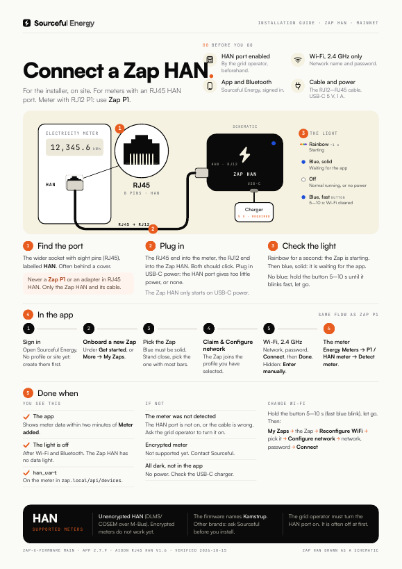
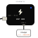

# Zap HAN: getting started

> **Applies to:** Zap HAN (for meters with an RJ45 HAN port), firmware 2.3.13 or later, the Sourceful Energy app 2.7.9 on mainnet
> **Last verified:** 2026-10-15, against the sources at the bottom
> **For:** the installer on site

The Zap HAN reads electricity meters that have an RJ45 HAN port (M-Bus). It sends the meter data over Wi-Fi to the Sourceful Energy app, like the [Zap P1](../zap/README.md) does for meters with an RJ12 P1 port.

**Going on site?** Print the one-pager: [English](zap-han-one-pager-en.pdf) · [Svenska](zap-han-one-pager-sv.pdf). Svenska: [README.sv.md](README.sv.md).

## The Zap HAN

The drawing is a schematic. Sourceful's sources have no photo or drawing of the Zap HAN yet, so it does not show where the sockets sit.

- **HAN socket (RJ12):** the cable to the meter's RJ45 HAN port.
- **USB-C:** power. Always needed.
- **One light** (RGB) and **the button**.

## Before you go

- [ ] **The HAN port is turned on by the grid operator.** On many meters both the HAN port and its power are off until the grid operator turns them on.
- [ ] **Wi-Fi name and password.** 2.4 GHz only.
- [ ] **The Sourceful Energy app**, signed in, with a profile and a site. **Bluetooth on.**
- [ ] **The cable** that comes with the Zap HAN: RJ12 on the Zap end, RJ45 on the meter end.
- [ ] **A USB-C charger**, 5 V. Sourceful's support recommends at least 1 A for the Zap.

## 1. Find the port on the meter

The wider socket with eight pins (RJ45, about 11.5 mm), labelled **HAN**. It often sits behind a small cover.

> **Warning:** Never plug a **Zap P1** or an RJ45-to-RJ12 adapter into the HAN port. The HAN port carries M-Bus voltage (12–24 V on Aidon meters), and that destroys a Zap P1. Only the Zap HAN with its own cable goes here. If the meter has a small RJ12 P1 port, use the [Zap P1](../zap/README.md) instead.

## 2. Plug in

1. Push the RJ45 end of the cable into the meter's HAN port. It should click.
2. Push the RJ12 end into the Zap HAN's HAN socket. It should click.
3. Plug in USB-C power.

The HAN port gives too little power for the Zap, or none: on Aidon meters at most about 0.7 W, and only once the grid operator has turned it on. The Zap HAN always runs on USB-C.

## 3. Check the light

- **Rainbow for about a second:** the Zap HAN is starting.
- **Blue, solid:** it is waiting for the app. Go to step 4.
- **No blue:** hold the button 5–10 seconds until blue blinks fast, then let go. The Wi-Fi settings are cleared and it starts waiting for the app.

> **Warning:** Let go while blue blinks fast. Past 10 seconds the light goes solid, and letting go then is a factory reset that also deletes the meter and other added devices.

The light is off in normal running. It is also off without power, so check in the app, not on the light.

## 4. In the app

The same as for the Zap P1:

1. Open Sourceful Energy and sign in. No profile or site yet: tap **Create new profile** or **Create new site** first.
2. Tap **Onboard a new Zap** under **Get started**. Or go to **More → My Zaps → Add a new Zap**.
3. Stand close. Pick the Zap with the most signal bars.
4. Tap **Claim & Configure network**.
5. Under **WiFi Setup**, pick the 2.4 GHz network, enter the password and tap **Connect**. Hidden network: **Enter manually**.
6. **WiFi Connected**: name the Zap if you like, then tap **Done**.

## 5. Add the meter

1. On the home screen, tap **Connect your meter, inverter or charger**. Or go to **More**, open the site, then **Energy devices → Add Energy Device**.
2. Tap **Onboard New Device**, then **Energy Meters** and **P1 / HAN meter**.
3. Tap **Detect meter**. The Zap HAN tries both its P1 and its HAN input and finds the settings by itself.
4. **Meter added** appears. Tap **Done**.

Meter data can take up to two minutes to appear.

## 6. Done when

- **The app** shows meter data.
- **The light** is off: Bluetooth stops about a minute after Wi-Fi is up.
- From a laptop on the same network, `http://zap.local/api/devices` lists the meter with `"detected_type": "han_uart"`. That means it reads the HAN port.

## The light and the button

| Light | Means |
| --- | --- |
| Rainbow for about a second | Starting |
| Blue, solid | Waiting for the app (Bluetooth, no Wi-Fi set) |
| Off | Normal running, or no power |

| Hold the button | While you hold | When you let go |
| --- | --- | --- |
| Less than 2 s | One short flash | Nothing |
| 2–5 s | Blue blinks slowly | The Zap restarts |
| 5–10 s | Blue blinks fast | Wi-Fi is cleared, the Zap waits for the app |
| More than 10 s | Blue is solid | Factory reset: Wi-Fi, connection settings and every added device are deleted |

## Change Wi-Fi

1. Hold the button 5–10 seconds until blue blinks fast, then let go.
2. In the app: **More → My Zaps**, tap the Zap, then **Reconfigure WiFi**.
3. Tap the Zap in the list, then **Configure network**.
4. Pick the network, enter the password and tap **Connect**.

## Meters

- The Zap HAN reads unencrypted HAN data (DLMS/COSEM over M-Bus, 2400 baud).
- Encrypted meters do not work yet: there is no setting for a key.
- The firmware names Kamstrup. For other brands, ask Sourceful before you install.

## Troubleshooting

| What you see | Probably | Do this |
| --- | --- | --- |
| **The meter was not detected** | The HAN port is not turned on, or the cable is not fully in | Push the cable in at both ends. Ask the grid operator to turn the HAN port on, then tap **Detect meter** again. |
| No light at all, the app does not find the Zap | No power | Check the USB-C charger and cable. |
| The app does not find the Zap | Blue is not solid, or the phone is too far away | Stand close. If the Zap was set up before, hold the button 5–10 s. |
| Meter added, but no data after a few minutes | Encrypted meter, or a brand that has not been checked | Contact Sourceful. |

## Open questions

- There is no photo or drawing of the Zap HAN in Sourceful's sources: how many sockets it has, their labels and which sides they are on.
- The cable: its length and its RJ12-to-RJ45 pin mapping are not documented. That it goes from RJ12 on the Zap to RJ45 in the meter comes from David (2026-10-15).
- The USB-C rating for the Zap HAN is not documented.
- Whether the Zap HAN has a power or data light besides the RGB light. The firmware mentions a hardware-driven P1 light.
- Which HAN meters are tested. Only Kamstrup is named in the code, and Sourceful's reference Zap HAN reads its Kamstrup through the P1 input, not the HAN input.
- The support site disagrees about HAN: the English pages call RJ45 HAN ports incompatible and say they give 24–36 V, the Swedish meter page lists HAN as a label for RJ12 ports, and one page says HAN ports give no power.

## Sources

- David (2026-10-15): the RJ12-to-RJ45 cable and the need for separate power
- Aidon, [RJ45 HAN Interface](https://aidon.com/wp-content/uploads/2023/06/AIDONFD_RJ45_HAN_Interface_EN.pdf) v1.6 A: pin 1 M-Bus data and power (12–24 V, 30 mA), pins 2 and 8 GND, pins 6–7 not connected, HAN port and power off until the grid company turns them on
- `srcfl/srcful-zap-x-firmware` on `main` (6da453f): `components/board/include/boards/zap-han.h` (HAN input 2400 8N1, one RGB light, button), `fw_controller/main/main.cpp` (rainbow at start), `fw_controller/main/main_loop.cpp` (blue light and button timings), `fw_controller/API.md` (`detected_type: han_uart`, the Zap HAN probes both inputs), `components/p1_data_reader/decoding/` (HDLC, DLMS/COSEM, M-Bus; no decryption), `fw_simulator/README.md` (the RJ12 HAN connector)
- `srcfl/srcful-flutter-app` at 9800165 (app 2.7.9): the onboarding is the same as for the Zap P1; the meter is added as **P1 / HAN meter** with **Detect meter** on firmware 2.3.13 or later
- A read-only check of Sourceful's reference Zap HAN (firmware 2.3.13), 2026-10-15
- The one-pager is built from [onepagers/zap_han.py](../onepagers/zap_han.py)
