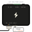

# Zap HAN: kom igång

> **Gäller:** Zap HAN (för mätare med RJ45 HAN-uttag), firmware 2.3.13 eller senare, Sourceful Energy-appen 2.7.9 på mainnet
> **Senast verifierad:** 2026-10-15, mot källorna längst ner
> **För:** installatören på plats

Zap HAN läser elmätare som har ett RJ45 HAN-uttag (M-Bus). Den skickar mätardata över wifi till Sourceful Energy-appen, precis som [Zap P1](../zap/README.sv.md) gör för mätare med RJ12 P1-port.

**Ska du ut på plats?** Skriv ut one-pagern: [Svenska](zap-han-one-pager-sv.pdf) · [English](zap-han-one-pager-en.pdf). English: [README.md](README.md).

## Zap HAN

Zap HAN har samma låda och samma uttag som [Zap P1](../zap/README.sv.md). Skillnaderna:

- **Ingen separat blå statuslampa.** Lampan i RJ12-uttaget är en RGB-lampa som gör det jobbet: regnbåge vid start, sedan blått som Zap P1:ans statuslampa.
- **Kabeln** som följer med går från **RJ12** på Zap (uttaget **IN**, på långsidan med USB-C) till **RJ45** i mätaren.
- **USB-C-ström behövs alltid.** HAN-porten ger inte Zap ström som en P1-port gör.

## Innan du åker

- [ ] **HAN-porten är påslagen av elnätsbolaget.** På många mätare är både HAN-porten och dess ström avstängda tills elnätsbolaget slår på dem.
- [ ] **Wifi-namn och lösenord.** Bara 2,4 GHz.
- [ ] **Sourceful Energy-appen**, inloggad, med en profil och en anläggning. **Bluetooth på.**
- [ ] **Kabeln** som följer med Zap HAN: RJ12 i Zap-änden, RJ45 i mätaränden.
- [ ] **En USB-C-laddare**, 5 V, minst 1 A.

## 1. Hitta porten på mätaren

Det bredare uttaget med åtta stift (RJ45, ungefär 11,5 mm), märkt **HAN**. Det sitter ofta bakom ett litet lock.

> **Varning:** Sätt aldrig en **Zap P1** eller en adapter från RJ45 till RJ12 i HAN-uttaget. HAN-porten har M-Bus-spänning (12–24 V på Aidon-mätare), och den förstör en Zap P1. Bara Zap HAN med sin egen kabel ska sitta här. Har mätaren ett litet RJ12 P1-uttag: använd [Zap P1](../zap/README.sv.md) i stället.

## 2. Koppla in

1. Tryck in kabelns RJ45-ände i mätarens HAN-uttag. Den ska klicka.
2. Tryck in RJ12-änden i Zap HAN:s uttag **IN**, på långsidan med USB-C. Den ska klicka.
3. Sätt i USB-C-strömmen.

HAN-porten ger inte Zap ström: på Aidon-mätare högst ungefär 0,7 W, och först när elnätsbolaget har slagit på den. Zap HAN drivs alltid med USB-C.

## 3. Kolla lampan

Lampan sitter i RJ12-uttaget.

- **Regnbåge i ungefär en sekund:** Zap HAN startar.
- **Blå, fast:** den väntar på appen. Gå till steg 4.
- **Ingen blå:** håll knappen 5–10 sekunder tills den blå blinkar snabbt, släpp. Wifi-uppgifterna rensas och den börjar vänta på appen.

> **Varning:** Släpp medan den blå blinkar snabbt. Efter 10 sekunder lyser den fast, och släpper du då blir det en fabriksåterställning som också raderar mätaren och andra tillagda enheter.

Lampan är släckt i normal drift. Den är också släckt utan ström, så kontrollera i appen, inte på lampan.

## 4. I appen

Samma som för Zap P1:

1. Öppna Sourceful Energy och logga in. Saknas profil eller anläggning: tryck **Skapa profil** eller **Skapa ny anläggning** först.
2. Tryck **Lägg till en ny Zap** under **Kom igång**. Eller gå till **Mer → Mina Zappar → Lägg till en ny Zap**.
3. Stå nära. Välj den Zap som har flest signalstaplar.
4. Tryck **Registrera & konfigurera nätverk**.
5. Under **WiFi-inställningar**: välj 2,4 GHz-nätet, skriv lösenordet och tryck **Anslut**. Dolt nät: **Ange manuellt**.
6. **WiFi anslutet**: namnge Zappen om du vill, tryck **Klar**.

## 5. Lägg till mätaren

1. På hemskärmen: tryck **Anslut din elmätare, växelriktare eller laddare**. Eller gå till **Mer**, öppna anläggningen, sedan **Energienheter → Lägg till energienhet**.
2. Tryck **Lägg till ny enhet**, sedan **Elmätare** och **P1 / HAN-mätare**.
3. Tryck **Identifiera mätare**. Zap HAN provar både sin P1- och sin HAN-ingång och hittar inställningarna själv.
4. **Mätaren är tillagd** visas. Tryck **Klar**.

Det kan ta upp till två minuter innan mätvärden visas.

## 6. Klart när

- **Appen** visar mätardata.
- **Lampan** är släckt: Bluetooth stängs ungefär en minut efter att wifi är uppe.
- Från en dator på samma nät listar `http://zap.local/api/devices` mätaren med `"detected_type": "han_uart"`. Det betyder att den läser HAN-porten.

## Lampan och knappen

| Lampa | Betyder |
| --- | --- |
| Regnbåge i ungefär en sekund | Startar |
| Blå, fast | Väntar på appen (Bluetooth, inget wifi inställt) |
| Släckt | Normal drift, eller ingen ström |

| Håll knappen | Medan du håller | När du släpper |
| --- | --- | --- |
| Kortare än 2 s | En kort blink | Ingenting |
| 2–5 s | Blå blinkar långsamt | Zap startar om |
| 5–10 s | Blå blinkar snabbt | Wifi rensas, Zap väntar på appen |
| Längre än 10 s | Blå lyser fast | Fabriksåterställning: wifi, anslutningsinställningar och alla tillagda enheter raderas |

## Byta wifi

1. Håll knappen 5–10 sekunder tills den blå blinkar snabbt, släpp.
2. I appen: **Mer → Mina Zappar**, tryck på Zappen, sedan **Konfigurera om WiFi**.
3. Tryck på Zappen i listan, sedan **Konfigurera Nätverk**.
4. Välj nät, skriv lösenordet och tryck **Anslut**.

## Mätare

- Zap HAN läser okrypterad HAN-data (DLMS/COSEM över M-Bus, 2400 baud).
- Krypterade mätare fungerar inte än: det finns ingen inställning för en nyckel.
- Testad med Kamstrup. För andra märken: fråga Sourceful innan du installerar.

## Felsökning

| Det du ser | Troligen | Gör så här |
| --- | --- | --- |
| **Mätaren kunde inte identifieras** | HAN-porten är inte påslagen, eller kabeln sitter inte i helt | Tryck in kabeln i båda ändar. Be elnätsbolaget slå på HAN-porten, tryck sedan **Identifiera mätare** igen. |
| Ingen lampa alls, appen hittar inte Zap | Ingen ström | Kontrollera USB-C-laddaren och kabeln. |
| Appen hittar inte Zap | Blå lyser inte fast, eller telefonen är för långt bort | Stå nära. Har Zap varit uppsatt förut: håll knappen 5–10 s. |
| Mätaren är tillagd men ingen data efter några minuter | Krypterad mätare, eller ett märke som inte är kontrollerat | Kontakta Sourceful. |

## Öppna frågor

- Supportsajten säger emot sig själv om HAN: de engelska sidorna kallar RJ45 HAN inkompatibelt och säger att det ger 24–36 V, den svenska mätarsidan räknar HAN som en etikett på RJ12-uttag, och en sida säger att HAN-portar inte ger någon ström.

## Källor

- David (2026-10-15): samma låda och uttag som Zap P1, RGB-lampan i RJ12-uttaget i stället för en separat blå lampa, kabeln från RJ12 till RJ45, USB-C-ström (5 V, minst 1 A) eftersom HAN-porten inte driver Zap, testad med Kamstrup
- Aidon, [RJ45 HAN Interface](https://aidon.com/wp-content/uploads/2023/06/AIDONFD_RJ45_HAN_Interface_EN.pdf) v1.6 A: stift 1 M-Bus data och ström (12–24 V, 30 mA), stift 2 och 8 GND, stift 6–7 kopplas inte, HAN-porten och strömmen är av tills elnätsbolaget slår på dem
- `srcfl/srcful-zap-x-firmware` på `main` (6da453f): `components/board/include/boards/zap-han.h` (HAN-ingång 2400 8N1, en RGB-lampa, knapp), `fw_controller/main/main.cpp` (regnbåge vid start), `fw_controller/main/main_loop.cpp` (blå lampa och knapptider), `fw_controller/API.md` (`detected_type: han_uart`, Zap HAN provar båda ingångarna), `components/p1_data_reader/decoding/` (HDLC, DLMS/COSEM, M-Bus; ingen dekryptering), `fw_simulator/README.md` (RJ12-HAN-kontakten)
- `srcfl/srcful-flutter-app` vid 9800165 (appen 2.7.9): onboardingen är densamma som för Zap P1; mätaren läggs till som **P1 / HAN-mätare** med **Identifiera mätare** på firmware 2.3.13 eller senare
- Läsande kontroll av Sourcefuls referens-Zap HAN (firmware 2.3.13), 2026-10-15
- One-pagern byggs från [onepagers/zap_han.py](../onepagers/zap_han.py); RJ45-uttaget följer Open Connector Graphics (Wikke Andeweg, CC BY 4.0)
