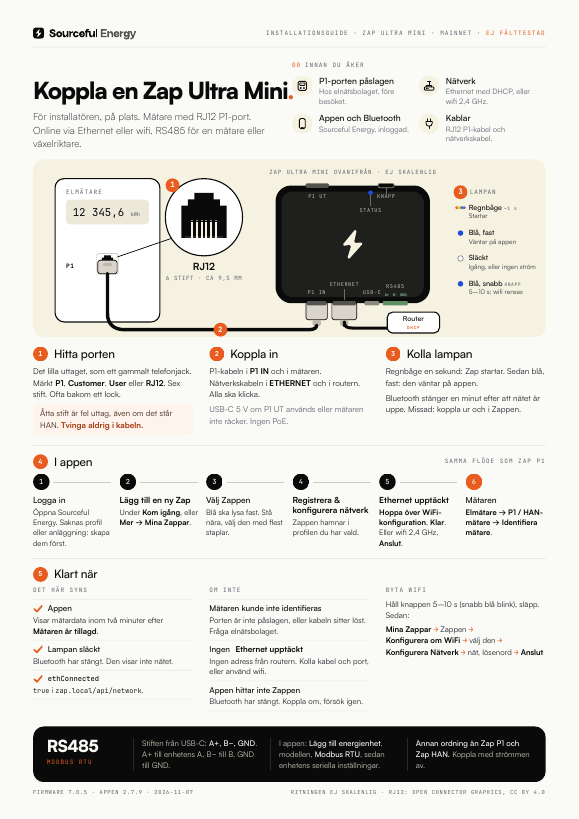
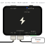

# Zap Ultra Mini: kom igång

> **Gäller:** Zap Ultra Mini (för mätare med RJ12 P1-port), firmware 7.0.5 eller senare, Sourceful Energy-appen 2.7.9 på mainnet  
> **Senast verifierad:** 2026-11-07, mot källorna längst ner  
> **För:** installatören på plats  
> **Fälttest:** inte gjort än. Checklista: [CHECKLIST.md](CHECKLIST.md)

Zap Ultra Mini läser elmätarens P1-port (RJ12), precis som [Zap P1](../zap/README.sv.md), och skickar mätardata till Sourceful Energy-appen via **Ethernet eller wifi**. Dess RS485-plint tar en mätare eller växelriktare över Modbus RTU.

Har mätaren bara ett RJ45 HAN-uttag? Då behövs [Zap HAN](../zap-han/README.sv.md).

**Ska du ut på plats?** Skriv ut one-pagern: [Svenska](zap-ultra-mini-one-pager-sv.pdf) · [English](zap-ultra-mini-one-pager-en.pdf). English: [README.md](README.md).

## Zap Ultra Mini

Ritningen visar portarnas ordning, inte de verkliga proportionerna.

| IN-sidan, från vänster | UT-sidan, från vänster |
| --- | --- |
| **P1 IN** (RJ12): kabeln till mätaren | **Knappen** |
| **Ethernet** (RJ45) | **Statuslampan** |
| **USB-C**: ström, vid behov | En lampa för **P1 UT** |
| En strömlampa | **P1 UT** (RJ12) |
| **RS485**-plinten: **A+, B−, GND**, räknat från USB-C | |

## Innan du åker

- [ ] **P1-porten är påslagen hos elnätsbolaget.** Oftast på deras webbplats, annars per telefon.
- [ ] **Ett nätverk:** en nätverkskabel till en router- eller switchport som delar ut adresser (DHCP), eller namn och lösenord till ett wifi på 2,4 GHz.
- [ ] **Sourceful Energy-appen**, inloggad, med en profil och en anläggning. **Bluetooth på** i telefonen.
- [ ] **En RJ12 P1-kabel** och, för Ethernet, en nätverkskabel.
- [ ] **En USB-C-laddare** (5 V) om något ska kopplas till P1 UT, eller om mätaren är äldre än P1 version 5.0.

## 1. Hitta porten på mätaren

Det lilla uttaget, som ett gammalt telefonjack: RJ12, sex stift. Det är märkt **P1**, **Customer**, **User** eller **RJ12**, och sitter ofta bakom ett litet lock.

> **Varning:** Ett bredare uttag med åtta stift (RJ45) är fel uttag, även om det står HAN. Använd aldrig en adapter och tvinga aldrig i kabeln. En mätare med bara ett RJ45 HAN-uttag behöver [Zap HAN](../zap-han/README.sv.md).

## 2. Koppla in

1. Tryck in P1-kabeln i Zappens **P1 IN**, på långsidan med Ethernet och USB-C, och andra änden i mätarens P1-port. Båda ska klicka.
2. För Ethernet: en nätverkskabel från **Ethernet** till routern eller switchen. Zap får sin adress via DHCP; det finns ingen inställning för fast adress.

En mätare med P1 version 5.0 driver Zap via kabeln. Sätt i USB-C (5 V) också när:

- något är kopplat till **P1 UT**. Det här är ett krav.
- mätaren är äldre och inte ger tillräckligt med ström: lampan förblir släckt.

Zap kan inte ta ström från nätverkskabeln (ingen PoE).

## 3. Kolla lampan

- **Regnbåge** ungefär en sekund: Zap startar.
- **Blå, fast:** Zap väntar på appen via Bluetooth. Gå till steg 4.

Så länge inget wifi är sparat öppnas Bluetooth vid varje start. När Zap är online, via Ethernet eller wifi, stänger Bluetooth efter **en minut**. Ha appen redo innan du sätter i nätverkskabeln. Missade du den? Dra ur Zappen (P1-kabeln och USB-C) och sätt i den igen.

> **Varning:** Håller du knappen längre än 10 sekunder och släpper blir det en fabriksåterställning: den raderar wifi och alla enheter som lagts till på Zap.

## 4. I appen

1. Öppna Sourceful Energy och logga in. Saknas profil eller anläggning: skapa dem först.
2. Tryck **Lägg till en ny Zap** under **Kom igång**. Eller gå till **Mer → Mina Zappar → Lägg till en ny Zap**.
3. Stå nära Zappen och välj den med flest staplar.
4. Tryck **Registrera & konfigurera nätverk**. Zappen hamnar i profilen du har vald.
5. **WiFi-inställningar** öppnas. Med nätverkskabeln i visas **Ethernet upptäckt** inom ungefär tio sekunder: tryck **Hoppa över WiFi-konfiguration**. Appen stänger Bluetooth och visar **Ansluten via Ethernet**. Namnge Zappen om du vill och tryck **Klar**.
6. Utan Ethernet: välj nätet på 2,4 GHz, skriv lösenordet, tryck **Anslut** och sedan **Klar**, som på [Zap P1](../zap/README.sv.md#4-i-appen).

Du kan också ställa in wifi med kabeln i, som reserv. När båda är uppe skickar Zap sin data via wifi.

## 5. Lägg till mätaren

Zap läser inte mätaren förrän mätaren är tillagd i appen.

1. Gå till **Mer**, öppna anläggningen, sedan **Energienheter → Lägg till energienhet**.
2. Tryck **Lägg till ny enhet**, sedan **Elmätare** och **P1 / HAN-mätare**.
3. Tryck **Identifiera mätare**. **Mätaren är tillagd** visas. Tryck **Klar**.

Det kan ta upp till två minuter innan mätardata syns.

## 6. Klart när

- **Appen** visar mätardata.
- **Statuslampan** är släckt: Bluetooth har stängt. Lampan visar inte om nätet fungerar.

På en dator i samma nät visar `http://zap.local/api/network` `"ethConnected": true` för Ethernet, och `"internetConnected": true` och `"mqttConnected": true` när Zap når Sourceful. `http://zap.local/api/devices` listar mätaren; dess `sn` börjar med `p1m-`.

## RS485

Plinten på IN-sidan tar en eller flera Modbus RTU-enheter, var och en med eget enhets-ID, om appen visar **Modbus RTU** för modellen.

1. Koppla med strömmen av. Stiften, räknat från USB-C: **A+, B−, GND**. **A+** till enhetens A, **B−** till dess B, **GND** till dess GND.
2. I appen: **Mer**, anläggningen, **Energienheter → Lägg till energienhet → Lägg till ny enhet**, typen och modellen. Under **Konfigurera anslutning**: välj **Modbus RTU** och fyll i **Baud Rate**, **Unit ID**, **Parity**, **Data Bits** och **Stop Bits** som de är inställda på enheten.

> **Varning:** Ordningen skiljer sig från de andra Zapparna: [Zap P1](../zap/README.sv.md#via-rs485) har GND, A+, B−, [Zap HAN](../zap-han/README.sv.md#en-rs485-enhet) B−, GND, A+ och [Zap Ultra X2](../zap-ultra-x2/README.sv.md#rs485) B−, A+, GND.

En växelriktare på nätet (Modbus TCP) läggs till som på Zap P1: [Lägga till en växelriktare](../zap/README.sv.md#lägga-till-en-växelriktare).

## Byta wifi

1. Håll knappen 5–10 sekunder tills blått blinkar snabbt, släpp sedan. Zap glömmer wifi och startar om med Bluetooth öppet.
2. I appen: **Mer → Mina Zappar**, tryck på Zappen, sedan **Konfigurera om WiFi**.
3. Tryck på Zappen i listan, sedan **Konfigurera Nätverk**, välj nätet, skriv lösenordet och tryck **Anslut**.

## Lampan och knappen

| Lampa | Hur den ser ut | Betyder |
| --- | --- | --- |
| Status | Regnbåge, ungefär 1 s | Startar |
| Status | Blå, fast | Väntar på appen (Bluetooth öppet) |
| Status | Släckt | Igång, eller ingen ström. Den visar inte nätet: kolla appen |
| Vid P1 UT | Tänd medan data kommer in | Data från mätaren |

| Håll knappen | Medan du håller | När du släpper |
| --- | --- | --- |
| 2–5 s | Blinkar långsamt | Zap startar om |
| 5–10 s | Blinkar snabbt | Wifi rensas, Zap startar om och väntar på appen |
| Mer än 10 s | Fast | Fabriksåterställning: wifi, anslutningsinställningar och alla tillagda enheter raderas |

## Felsökning

| Det här ser du | Troligen | Gör så här |
| --- | --- | --- |
| Appen hittar inte Zappen | Bluetooth stängde en minut efter att Zap kom online | Dra ur Zappen och sätt i den, sök igen inom en minut. |
| **Ethernet upptäckt** visas inte | Ingen adress från routern (DHCP), eller kabeln sitter inte i | Kolla kabeln och routerporten. Eller ställ in wifi i stället. |
| **Mätaren kunde inte identifieras** | P1-porten är inte påslagen, eller kabeln sitter inte i | Tryck in kabeln i båda ändar. Be elnätsbolaget slå på porten. |
| Ingenting lyser | Ingen ström från mätaren | Sätt i USB-C (5 V). |
| En RS485-enhet ger ingen data | Kopplad efter en annan Zaps ordning, eller fel seriella inställningar | Koppla A+, B−, GND räknat från USB-C. Kontrollera baud rate, paritet och enhets-ID mot enheten. |

## Källor

- Hårdvaruleverantörens dokumentation för kortet, läst 2026-11-07: portarna på båda sidor och deras ordning, RS485-plinten (A+, B−, GND från USB-C), ström från en mätare med P1 version 5.0 eller USB-C, USB-C krävs när P1 UT används, ingen PoE
- `srcfl/srcful-zap-x-firmware` vid `v7.0.5` (346754de): `components/board/include/boards/zap-ultra-mini.h` (RGB-statuslampa, knapp, P1 in och ut, Modbus RTU på plinten), `fw_controller/main/main.cpp` (regnbåge vid start; Bluetooth öppnas utan sparat wifi, även med Ethernet), `fw_controller/main/main_loop.cpp` (blått medan Bluetooth väntar; Bluetooth stänger 60 s efter att wifi eller Ethernet är uppe; knapp 2/5/10 s), `components/p1_data_reader/p1_meter.cpp` (lampan vid P1 UT, data kopieras till P1 UT), `components/wifi/eth_manager.cpp` (DHCP, ingen fast adress), `fw_controller/API.md` (`ethConnected`, wifi föredras när båda är uppe)
- `srcfl/srcful-flutter-app` vid `v2.7.9`: `lib/screens/zap_wifi_setup_screen.dart` (**Ethernet upptäckt**, **Hoppa över WiFi-konfiguration**, **Ansluten via Ethernet**), `lib/l10n/app_sv.arb`; mätare och enheter läggs till som för [Zap P1](../zap/README.sv.md#källor)
- Device-support-registryts `connection-types` på mainnet: fälten för **Modbus RTU**, som inte är översatta
- Sourcefuls testrigg, 2026-11-07: en Zap Ultra Mini på firmware 7.0.5 läser en P1-mätare och en SDM630-mätare över RS485
- One-pagern byggs från [onepagers/zap_ultra_mini.py](../onepagers/zap_ultra_mini.py) och [onepagers/zap_ethernet.py](../onepagers/zap_ethernet.py); RJ12-uttaget följer Open Connector Graphics (Wikke Andeweg, CC BY 4.0)
