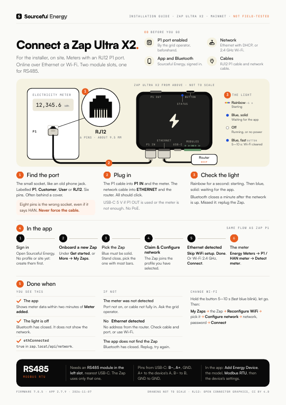
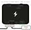

# Zap Ultra X2: getting started

> **Applies to:** Zap Ultra X2 (for meters with an RJ12 P1 port), firmware 7.0.5 or later, the Sourceful Energy app 2.7.9 on mainnet  
> **Last verified:** 2026-11-07, against the sources at the bottom  
> **For:** the installer on site  
> **Field test:** not done yet. Checklist: [CHECKLIST.md](CHECKLIST.md)

The Zap Ultra X2 reads the electricity meter's P1 port (RJ12), like the [Zap P1](../zap/README.md), and sends the data to the Sourceful Energy app over **Ethernet or Wi-Fi**. It has two module slots on one terminal; with an RS485 module in the left slot it reads a meter or inverter over Modbus RTU.

Does the meter only have an RJ45 HAN port? Then you need the [Zap HAN](../zap-han/README.md).

**Going on site?** Print the one-pager: [English](zap-ultra-x2-one-pager-en.pdf) · [Svenska](zap-ultra-x2-one-pager-sv.pdf). Svenska: [README.sv.md](README.sv.md).

## The Zap Ultra X2

The drawing shows the order of the ports, not the real proportions.

| IN side, from the left | OUT side, from the left |
| --- | --- |
| **P1 IN** (RJ12): the cable to the meter | The **button** |
| **Ethernet** (RJ45) | The **status light** |
| **USB-C**: power, when needed | **P1 OUT** (RJ12) |
| The 5-pin **module terminal**: **B−, A+** (left slot), **GND**, **B−, A+** (right slot), counted from USB-C | |

## Before you go

- [ ] **The P1 port is enabled by the grid operator.** Usually on their website, otherwise by phone.
- [ ] **A network:** an Ethernet cable to a router or switch port that hands out addresses (DHCP), or the name and password of a 2.4 GHz Wi-Fi network.
- [ ] **The Sourceful Energy app**, signed in, with a profile and a site. **Bluetooth on** on the phone.
- [ ] **An RJ12 P1 cable** and, for Ethernet, a network cable.
- [ ] **A USB-C charger** (5 V) if something will be plugged into P1 OUT, or if the meter is older than P1 version 5.0.
- [ ] For an RS485 device: **an RS485 module in the left slot**, nearest USB-C. Check before you go.

## 1. Find the port on the meter

The small socket, like an old telephone jack: RJ12, six pins. It is labelled **P1**, **Customer**, **User** or **RJ12**, and often sits behind a small cover.

> **Warning:** A wider socket with eight pins (RJ45) is the wrong one, even if it says HAN. Never use an adapter and never force the cable. A meter with only an RJ45 HAN port needs the [Zap HAN](../zap-han/README.md).

## 2. Plug in

1. Push the P1 cable into the Zap's **P1 IN**, on the long side with Ethernet and USB-C, and the other end into the meter's P1 port. Both should click.
2. For Ethernet: a network cable from **Ethernet** to the router or switch. The Zap gets its address by DHCP; there is no setting for a fixed address.

A meter with P1 version 5.0 powers the Zap through the cable. Plug in USB-C (5 V) as well when:

- something is plugged into **P1 OUT**. This one is required.
- the meter is older and does not give enough power: the light stays dark.

The Zap cannot take power from the network cable (no PoE).

## 3. Check the light

- **Rainbow** for about a second: the Zap is starting.
- **Blue, solid:** the Zap is waiting for the app over Bluetooth. Go to step 4.

As long as no Wi-Fi is saved, Bluetooth opens at every start. Once the Zap is online, over Ethernet or Wi-Fi, Bluetooth closes after **one minute**. Have the app ready before you plug in the network cable. Missed it? Unplug the Zap (P1 cable and USB-C) and plug it in again.

> **Warning:** Holding the button longer than 10 seconds and letting go is a factory reset: it deletes the Wi-Fi and every device added to the Zap.

## 4. In the app

1. Open Sourceful Energy and sign in. No profile or site yet: create them first.
2. Tap **Onboard a new Zap** under **Get started**. Or go to **More → My Zaps → Add a new Zap**.
3. Stand close to the Zap and pick the one with the most bars.
4. Tap **Claim & Configure network**. The Zap joins the profile you have selected.
5. **WiFi Setup** opens. With the network cable in, **Ethernet detected** appears within about ten seconds: tap **Skip WiFi setup**. The app closes Bluetooth and shows **Connected via Ethernet**. Name the Zap if you like and tap **Done**.
6. Without Ethernet: pick the 2.4 GHz network, enter the password, tap **Connect**, then **Done**, as on the [Zap P1](../zap/README.md#4-in-the-app).

You can also set up Wi-Fi with the cable in, as a backup. With both up, the Zap sends its data over Wi-Fi.

## 5. Add the meter

The Zap does not read the meter until the meter is added in the app.

1. Go to **More**, open the site, then **Energy devices → Add Energy Device**.
2. Tap **Onboard New Device**, then **Energy Meters** and **P1 / HAN meter**.
3. Tap **Detect meter**. **Meter added** appears. Tap **Done**.

Meter data can take up to two minutes to appear.

## 6. Done when

- **The app** shows meter data.
- **The status light** is off: Bluetooth has closed. The light does not show whether the network works.

On a laptop on the same network, `http://zap.local/api/network` shows `"ethConnected": true` for Ethernet, and `"internetConnected": true` and `"mqttConnected": true` once the Zap reaches Sourceful. `http://zap.local/api/devices` lists the meter; its `sn` starts with `p1m-`.

## RS485

The 5-pin terminal on the IN side is shared by two module slots. The Zap reads RS485 only on the **left slot**, nearest USB-C, and only with an **RS485 module** fitted there. Modules are fitted with the case open and the power off. The Zap does not check which module is fitted.

With the RS485 module in place, the terminal takes one or more Modbus RTU devices, each with its own unit ID, if the app lists **Modbus RTU** for the model.

1. Wire with the power off. The pins, counted from USB-C: **B−, A+** (left slot), **GND** (shared), then **B−, A+** of the right slot, which the Zap does not use. **A+** to the device's A, **B−** to its B, **GND** to its GND.
2. In the app: **More**, the site, **Energy devices → Add Energy Device → Onboard New Device**, the type and the model. Under **Configure Connection**, pick **Modbus RTU** and enter **Baud Rate**, **Unit ID**, **Parity**, **Data Bits** and **Stop Bits** as set on the device.

> **Warning:** The order differs from the other Zaps: the [Zap P1](../zap/README.md#over-rs485) has GND, A+, B−, the [Zap HAN](../zap-han/README.md#an-rs485-device) B−, GND, A+ and the [Zap Ultra Mini](../zap-ultra-mini/README.md#rs485) A+, B−, GND.

An inverter on the network (Modbus TCP) is added as on the Zap P1: [Add an inverter](../zap/README.md#add-an-inverter).

## Change Wi-Fi

1. Hold the button 5–10 seconds until blue blinks fast, then let go. The Zap forgets the Wi-Fi and restarts with Bluetooth open.
2. In the app: **More → My Zaps**, tap the Zap, then **Reconfigure WiFi**.
3. Tap the Zap in the list, then **Configure network**, pick the network, enter the password and tap **Connect**.

## The light and the button

| Light | How it looks | Means |
| --- | --- | --- |
| Status | Rainbow, about 1 s | Starting |
| Status | Blue, solid | Waiting for the app (Bluetooth open) |
| Status | Off | Running, or no power. It does not show the network: check the app |

| Hold the button | While you hold | When you let go |
| --- | --- | --- |
| 2–5 s | Blinks slowly | The Zap restarts |
| 5–10 s | Blinks fast | Wi-Fi is cleared, the Zap restarts and waits for the app |
| More than 10 s | Solid | Factory reset: Wi-Fi, connection settings and every added device are deleted |

## Troubleshooting

| What you see | Probably | Do this |
| --- | --- | --- |
| The app does not find the Zap | Bluetooth closed a minute after the Zap went online | Unplug the Zap and plug it in, then scan again within a minute. |
| **Ethernet detected** does not appear | No address from the router (DHCP), or the cable is not in | Check the cable and the router port. Or set up Wi-Fi instead. |
| **The meter was not detected** | The P1 port is not enabled, or the cable is not fully in | Push the cable in at both ends. Ask the grid operator to enable the port. |
| Nothing lights at all | No power from the meter | Plug in USB-C (5 V). |
| An RS485 device gives no data | No RS485 module in the left slot, wired to the right slot, or wrong serial settings | Use the left slot: B−, A+ nearest USB-C. Check baud rate, parity and unit ID against the device. |

## Sources

- The hardware vendor's documentation for this board, read 2026-11-07: the ports on both sides and their order, the module terminal (from USB-C: B−, A+ of the left slot on IO36/38/39, GND, B−, A+ of the right slot on IO41/43/44), modules fitted with the case open and the power off, power from a P1 version 5.0 meter or USB-C, no PoE; for the Zap Ultra Mini of the same family, USB-C when P1 OUT is used
- `srcfl/srcful-zap-x-firmware` at `v7.0.5` (346754de): `components/board/include/boards/zap-eth-s3.h` (RGB status light, button, P1 in and out, Modbus RTU on the left slot's pins RX 36 / TX 39 / RTS 38; the module sense pins are defined but not read), `fw_controller/README.md` (the sense pins are not read), `fw_controller/main/main.cpp` (rainbow at start; Bluetooth opens without saved Wi-Fi, also with Ethernet), `fw_controller/main/main_loop.cpp` (blue while Bluetooth waits; Bluetooth closes 60 s after Wi-Fi or Ethernet is up; button 2/5/10 s), `components/p1_data_reader/p1_meter.cpp` (data copied to P1 OUT), `components/wifi/eth_manager.cpp` (DHCP, no fixed address), `fw_controller/API.md` (`ethConnected`, Wi-Fi preferred when both are up)
- `srcfl/srcful-flutter-app` at `v2.7.9`: `lib/screens/zap_wifi_setup_screen.dart` (**Ethernet detected**, **Skip WiFi setup**, **Connected via Ethernet**), `lib/l10n/app_en_US.arb`; adding the meter and devices as for the [Zap P1](../zap/README.md#sources)
- The device-support registry's `connection-types` on mainnet: the **Modbus RTU** fields
- Sourceful's test rig, 2026-11-07: a Zap Ultra X2 on firmware 7.0.5 reads a P1 meter. RS485 on the X2 is not yet tested on the rig.
- The one-pager is built from [onepagers/zap_ultra_x2.py](../onepagers/zap_ultra_x2.py) and [onepagers/zap_ethernet.py](../onepagers/zap_ethernet.py); the RJ12 jack follows Open Connector Graphics (Wikke Andeweg, CC BY 4.0)
