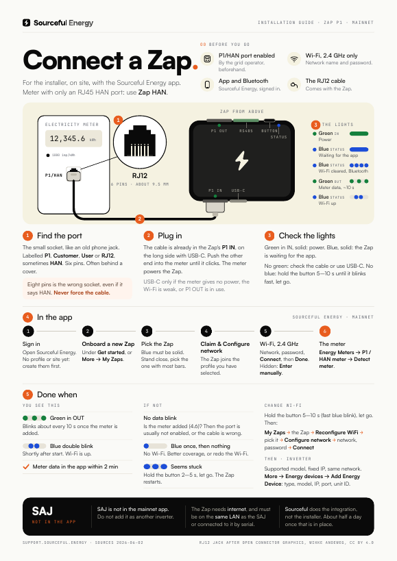
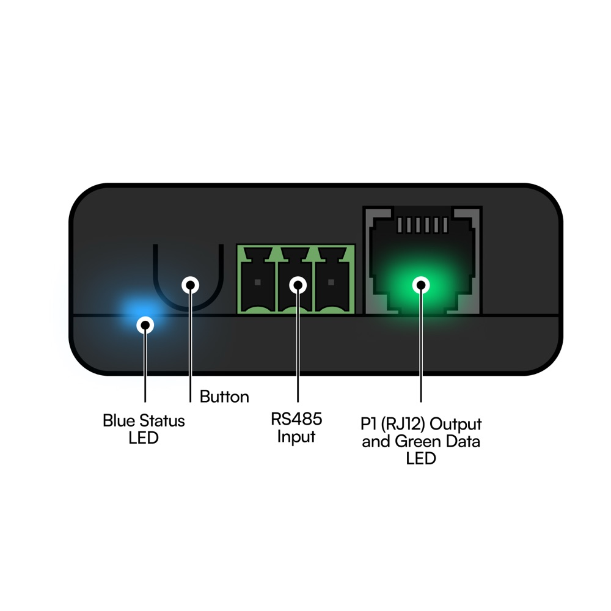

# Zap P1: getting started

> **Applies to:** Zap P1 (for meters with an RJ12 P1 port), current firmware (2.3.x), the Sourceful Energy app 2.7.9 on mainnet
> **Last verified:** 2026-10-15, against the sources at the bottom
> **For:** the installer on site, and anyone setting up their own Zap

The Zap P1 plugs into the electricity meter's P1 port (RJ12). It reads the meter and sends the data over Wi-Fi to the Sourceful Energy app. It can also read, and for some models control, an inverter on the same network.

Does the meter only have an RJ45 HAN port? Then you need the [Zap HAN](../zap-han/README.md), not this one.

**Going on site?** Print the one-pager: [English](zap-one-pager-en.pdf) · [Svenska](zap-one-pager-sv.pdf). Svenska: [README.sv.md](README.sv.md).

## Before you go

- [ ] **The P1/HAN port is enabled by the grid operator.** Usually on their website, otherwise by phone. Often free and done remotely; some send a technician.
- [ ] **Wi-Fi name and password.** The Zap uses 2.4 GHz only, WPA2 or WPA3.
- [ ] **The Sourceful Energy app** from the App Store or Google Play, signed in, with a profile and a site. If they are missing, the app asks you to create them first.
- [ ] **Bluetooth on** on the phone.
- [ ] **The RJ12 cable** that comes with the Zap. It is already plugged into the Zap.

The Zap works with P1 meters in Austria, Belgium, Denmark, Finland, Hungary, Ireland, Lithuania, Luxembourg, the Netherlands, Portugal and Sweden. In Austria, encrypted meter data is not supported yet. For other countries, contact Sourceful support.

## The Zap from every side

The ports sit on the two long sides.

| IN side | OUT side |
| --- | --- |
|  |  |
| **P1 IN** (RJ12): the cable to the meter. Green power LED inside the port. | **Blue status LED** and the **button** |
| **USB-C**: extra power, only when needed | **RS485 terminal** |
| | **P1 OUT** (RJ12), with the green data LED inside the port |

## 1. Find the port on the meter

The small socket, like an old telephone jack: RJ12, six pins, about 9.5 mm wide. It is labelled **P1**, **Customer**, **User** or **RJ12**, sometimes **HAN**. It often sits behind a small cover.

> **Warning:** A wider socket with eight pins (RJ45, about 11.5 mm) is the wrong one for the Zap P1, even if it says HAN. It can carry 24–36 V where the Zap P1 expects 5 V, and that destroys it. Never use an RJ45-to-RJ12 adapter. If the cable sits loose or meets resistance, do not force it. A meter with only an RJ45 HAN port needs the [Zap HAN](../zap-han/README.md) and its own cable.

## 2. Plug in

1. The cable is already in the Zap's **P1 IN**, on the long side with USB-C.
2. Push the other end all the way into the meter's P1/HAN port. It should click.

The meter powers the Zap. Add USB-C power (5 V, at least 1 A) when:

- something is plugged into **P1 OUT**. This one is required.
- the meter does not give enough power.
- the meter is far from the Wi-Fi router.

## 3. Check the lights

- **Green in P1 IN, solid:** the Zap has power. Off: check the cable, or power it with USB-C.
- **Blue, solid:** the Zap is waiting for the app. Go to step 4.
- **Blue off:** hold the button 5–10 seconds until blue blinks fast, then let go. The Wi-Fi settings are cleared and the Zap starts waiting for the app.

> **Warning:** Let go while blue blinks fast. If you hold past 10 seconds, blue goes solid, and letting go then is a factory reset: it also deletes the inverters and other devices added to the Zap.

## 4. In the app

1. Open Sourceful Energy and sign in. No profile or site yet: tap **Create new profile** or **Create new site** first. You set the site's location there.
2. Tap **Onboard a new Zap** under **Get started**. Or go to **More → My Zaps → Add a new Zap**.
3. Stand close to the Zap. The app scans over Bluetooth for a few seconds and lists every Zap it finds, with signal bars. The list is not sorted: pick the one with the most bars. Nothing found: tap the line to scan again.
4. Tap **Claim & Configure network**. The Zap joins the profile you have selected in the app.
5. Under **WiFi Setup**, pick the 2.4 GHz network, enter the password and tap **Connect**. Hidden network: **Enter manually** and type the network name. It can take up to 30 seconds.
6. **WiFi Connected**: name the Zap if you like, then tap **Done**.

## 5. Add the meter

The Zap does not start reading the meter until the meter is added in the app.

1. On the home screen, tap **Connect your meter, inverter or charger**. Or go to **More**, open the site, then **Energy devices → Add Energy Device**.
2. Tap **Onboard New Device**, then **Energy Meters** and **P1 / HAN meter**.
3. Tap **Detect meter**. The Zap finds the meter and its serial settings by itself.
4. **Meter added** appears. Tap **Done**.

Meter data can take up to two minutes to appear.

## 6. Done when

- **Green in P1 OUT** blinks about every ten seconds. The meter is answering.
- **Blue** double-blinked shortly after start, usually within 30 seconds, and is off now. Wi-Fi is up.
- **The app** shows meter data.

### Check it from a laptop (optional)

On the same network as the Zap:

- `http://zap.local/api/network` shows `"internetConnected": true` and `"mqttConnected": true` when the Zap reaches Sourceful, and the Wi-Fi signal as `rssi`.
- `http://zap.local/api/devices` lists the meter; its `sn` starts with `p1m-`. `http://zap.local/api/devices/<sn>/data/json` shows the live meter values.

`zap.local` answers for one Zap per network. Every Zap also answers on `zap-<serial>.local`, and the router lists it as `zap-<serial>`. Checked on Zaps with firmware 2.3.13 and 2.3.25.

## Add an inverter

The inverter must be a model the app supports, on the same network as the Zap, with Modbus TCP enabled and a fixed IP address (or a DHCP reservation).

1. Go to **More**, open the site, then **Energy devices → Add Energy Device**. Or tap **+** on the site card on the home screen.
2. With more than one Zap: **Select Gateway**.
3. Tap **Onboard New Device**, then the type (**Inverters**) and the model.
4. Under **Configure Connection**, enter **Host Address** (the inverter's IP), **Port** and **Unit ID**. Tap **Continue**.
5. Check the summary and tap **Connect Device**. Then **Enable Resources** and **Done**.

The app does not scan the network for inverters. You type the IP address.

| Usual Modbus TCP settings | |
| --- | --- |
| Port | 502. SolarEdge 1502, Huawei 6607, Deye 8899 |
| Unit ID | 1, sometimes 0. SMA uses 3 |

- Many inverter dongles allow only one Modbus connection. A Solis inverter stops reporting to Solis Cloud while the Zap is connected.
- Sungrow needs a direct network connection. WiNet-S and other dongles do not work.

## Change Wi-Fi

1. Hold the button 5–10 seconds until blue blinks fast, then let go. The Zap forgets the old network.
2. In the app: **More → My Zaps**, tap the Zap. It shows **Unable to reach Zap**: tap **Reconfigure WiFi**.
3. Tap the Zap in the list, then **Configure network**.
4. Pick the network, enter the password and tap **Connect**.

If the Zap is still online, the button is **Configure Network** on the **Network** card instead.

## The lights and the button

| Light | How it looks | Means |
| --- | --- | --- |
| Green in P1 IN | Solid | Power |
| Green in P1 IN | Off | No power. Check the cable, or use USB-C. |
| Green in P1 OUT | Blinks about every 10 s | Data from the meter |
| Green in P1 OUT | Never blinks | The P1 port is probably not enabled. Contact the grid operator. |
| Blue | Solid | Waiting for the app (Bluetooth, no Wi-Fi set) |
| Blue | One blink at start | The Zap is starting |
| Blue | Double blink shortly after start | Connected to Wi-Fi |
| Blue | One blink at start, never a double blink | Wi-Fi failed |

| Hold the button | While you hold | When you let go |
| --- | --- | --- |
| Less than 2 s | One short blink | Nothing |
| 2–5 s | Blue blinks slowly | The Zap restarts |
| 5–10 s | Blue blinks fast | Wi-Fi is cleared, the Zap waits for the app |
| More than 10 s | Blue is solid | Factory reset: Wi-Fi, connection settings and every added device are deleted |

The app has no restart button. Use the button.

## Troubleshooting

| What you see | Probably | Do this |
| --- | --- | --- |
| No data blink | The meter is not added in the app, the P1 port is not enabled, or the cable is not fully in | Add the meter (step 5). Push the cable in at both ends. Ask the grid operator to enable the port. |
| **The meter was not detected** in the app | The cable, or the port is not enabled | Check the cable and the port, then tap **Detect meter** again. |
| Blue blinks once at start and never again | The Zap cannot reach the saved Wi-Fi: new router or password, a 5 GHz-only router, MAC filtering, a full DHCP pool, or a metal cabinet | Hold the button 5–10 s; solid blue means it worked. Set up Wi-Fi again on a 2.4 GHz network. |
| The app does not find the Zap | Blue is not solid, or the phone is too far away | Turn Bluetooth on, stand close. If the Zap was set up before, hold the button 5–10 s. |
| No green light in P1 IN | No power from the meter | Check the cable. Power the Zap with USB-C. |
| Meter data at `zap.local/api/devices` but not in the app | `"mqttConnected": false` at `/api/network`: no internet, or the Zap needs a restart | Check the internet connection. Unplug the Zap for 10 seconds. |
| The Zap seems stuck | | Hold the button 2–5 s and let go. |
| The Zap is hot, smells burnt or is discoloured | Wrong port or damage | Unplug it from the meter and USB at once. Do not reconnect it. Send photos to Sourceful support. |

## Safety

- Use the Zap only with compatible P1 meters. Never with an unknown port.
- Indoors and dry only, typically between −20 and +40 °C. Keep it away from rain, sun and heat.
- Do not use a Zap with a damaged or cracked casing.
- Push the plug all the way in.
- Installation by a competent person. A wrong connection can affect the meter or its data.
- The Zap has Wi-Fi and Bluetooth radios. Follow local rules for radio equipment.

## SAJ

SAJ is not in the mainnet app. Do not add an SAJ as another inverter.

For the SAJ integration, the Zap needs internet and must be on the same network as the SAJ, or connected to it by serial. Sourceful does the integration, not the installer. It takes about half a day once that is in place.

## Open questions

These are places where the sources disagree. The steps above follow the app and the firmware.

- The support articles say **Connect a Zap** or **Register a Zap**. App 2.7.9 has no such button; it says **Onboard a new Zap** or **Add a new Zap**.
- The Wi-Fi article lists **Reconfigure Wi-Fi → Connect → Configure Network**. In the app the order is **Reconfigure WiFi**, pick the Zap, **Configure network**, then **Connect**.
- The support articles describe green, orange and red signal colours. The app shows orange signal bars.
- The support articles say the app can scan the network for inverters. App 2.7.9 has no scan; you type the IP.
- The support articles say the green data light blinks as soon as the Zap is on Wi-Fi. On firmware 2.3.x the Zap only reads the meter, and the light only blinks, after the meter is added in the app (step 5).
- The support articles give 5 s and 10 s for a reset. The firmware does both: 5 s clears Wi-Fi, 10 s is a full factory reset.
- The terminal on the OUT side is called **RS485 Input** in the product images. The reference manual says it is reserved for future sensors and not active, while some brand guides wire inverters to it.
- "Zap beyond P1 meters" names firmware 1.2.1 and 1.6.20. The firmware repository has used 2.x since November 2025.
- The "no data in the app" article points to `http://zap.local/api/data/p1/obis` and an `esp32c3-…` name in the router. On firmware 2.3.13 and 2.3.25 that address returns 404 and the router shows `zap-<serial>`. The local status page at `http://zap.local/` is only in the testnet builds (2.3.24 and later), not in the stable 2.3.17.
- SAJ is not on the support site. That section comes from Sourceful's internal installation brief.

## Sources

- Support articles on support.sourceful.energy, all updated 2026-06-02: [reference manual](https://support.sourceful.energy/en/zap-reference-manual), [connect Zap to the meter](https://support.sourceful.energy/en/how-to-connect-zap-to-your-electricity-meter), [connect Zap to an inverter](https://support.sourceful.energy/en/how-to-connect-zap-to-your-inverter), [compatible meters](https://support.sourceful.energy/en/which-electricity-meters-are-compatible-with-sourceful-energy), [compatible inverters](https://support.sourceful.energy/en/which-inverters-are-compatible-with-sourceful-energy), [Modbus TCP on the inverter](https://support.sourceful.energy/en/how-do-i-know-if-modbus-tcp-is-activated-on-my-inverter), [reconfigure Wi-Fi](https://support.sourceful.energy/en/zap-reconfigure-wifi-firmware-v2-2-0), [no data in the app](https://support.sourceful.energy/en/troubleshooting-zap-connected-but-no-data-in-app), [blue LED blinks then turns off](https://support.sourceful.energy/en/troubleshooting-blue-status-led-blinking-then-turning-off), [overheating or wrong port](https://support.sourceful.energy/en/troubleshooting-zap-overheating-or-connected-to-wrong-port), [safety information](https://support.sourceful.energy/en/zap-safety-information)
- Button timings: `srcfl/srcful-zap-x-firmware`, `fw_controller/main/main_loop.cpp` on `main` (6da453f9)
- The meter is not added automatically: `fw_controller/main/main.cpp` (`MIGRATION_ENABLED 0` on `main`, v2.3.13 and v2.3.17); the data light is driven by the P1 reader: `components/p1_data_reader/p1_meter.cpp`, `components/board/include/boards/zap-p1.h`
- Adding the meter: `srcfl/srcful-flutter-app` at 9800165, `lib/utils/smart_meter_onboarding_policy.dart`, `lib/screens/device_onboard/onboard_steps.dart`
- Local endpoints and names: `srcfl/srcful-zap-x-firmware`, `fw_controller/API.md` and `components/wifi/wifi_manager.cpp`; read-only checks on two Zaps (firmware 2.3.13 and 2.3.25), 2026-10-15
- App flows and labels: `srcfl/srcful-flutter-app` at 9800165 (app 2.7.9), `lib/screens/zap_onboard_screen.dart`, `zap_wifi_setup_screen.dart`, `zap_detail/zap_detail_screen.dart`, `device_onboard/`, `lib/l10n/app_en_US.arb`
- Product images: `srcfl/srcful-marketing-website`, `public/assets/images/zap/`
- SAJ: Sourceful's internal installation brief, 2026-10-14
- The one-pager is built from [onepagers/zap.py](../onepagers/zap.py)
