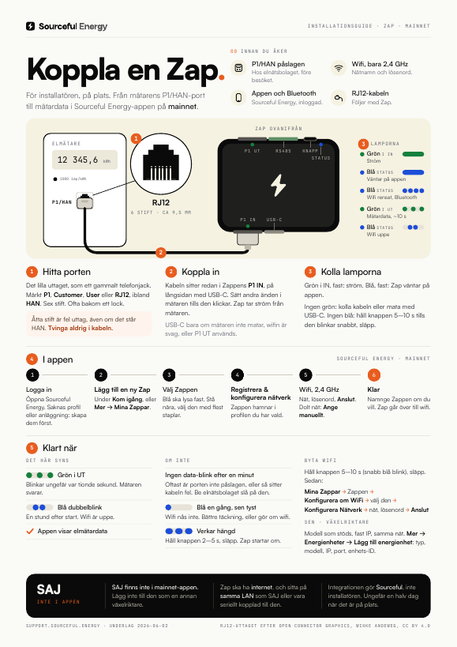
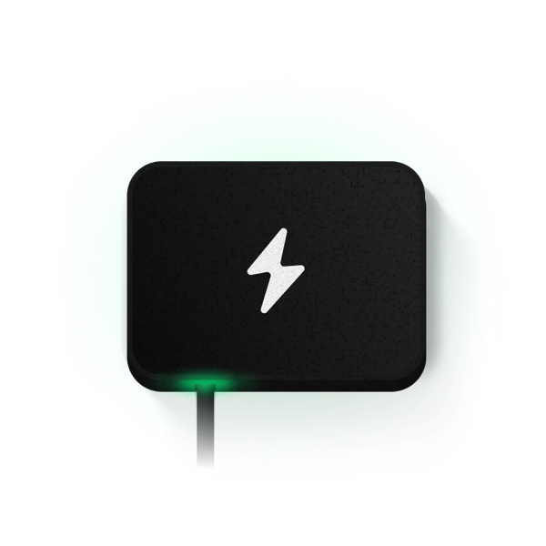
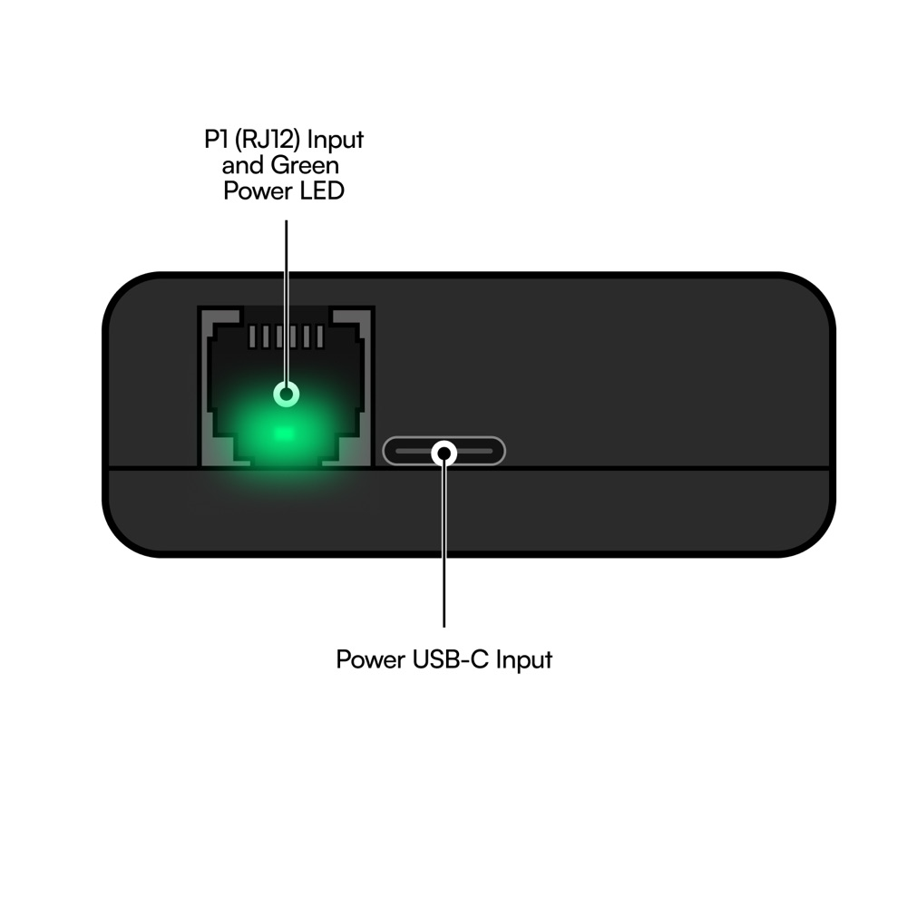
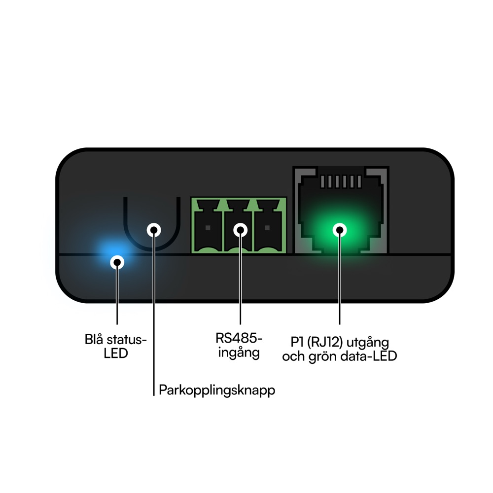

# Zap: kom igång

> **Gäller:** Zap med P1/HAN-ingång, aktuell firmware (2.3.x), Sourceful Energy-appen 2.7.9 på mainnet
> **Senast verifierad:** 2026-10-15, mot källorna längst ner
> **För:** installatören på plats, och den som sätter upp sin egen Zap

Zap sitter i elmätarens P1/HAN-port. Den läser mätaren och skickar mätardata över wifi till Sourceful Energy-appen. Den kan också läsa, och för vissa modeller styra, en växelriktare på samma nät.

**Ska du ut på plats?** Skriv ut one-pagern: [Svenska](zap-one-pager-sv.pdf) · [English](zap-one-pager-en.pdf). English: [README.md](README.md).

Knappnamnen nedan är de som appen visar på svenska. Står telefonen på engelska, se [README.md](README.md).

## Innan du åker

- [ ] **P1/HAN-porten är påslagen hos elnätsbolaget.** Oftast på deras webb, annars via telefon. Ofta gratis och på distans, ibland kommer en tekniker.
- [ ] **Wifi-namn och lösenord.** Zap tar bara 2,4 GHz, WPA2 eller WPA3.
- [ ] **Sourceful Energy-appen** från App Store eller Google Play, inloggad, med en profil och en anläggning. Saknas de ber appen dig skapa dem först.
- [ ] **Bluetooth på** i telefonen.
- [ ] **RJ12-kabeln** som följer med Zap. Den sitter redan i Zappen.

Zap fungerar med P1-mätare i Belgien, Danmark, Finland, Irland, Litauen, Luxemburg, Nederländerna, Portugal, Sverige, Ungern och Österrike. I Österrike stöds ännu inte krypterad mätardata. För andra länder: kontakta Sourcefuls support.

## Zap från alla håll

Portarna sitter på de två långsidorna.

| IN-sidan | UT-sidan |
| --- | --- |
|  |  |
| **P1 IN** (RJ12): kabeln till mätaren. Grön ström-LED i porten. | **Blå status-LED** och **knappen** |
| **USB-C**: extra ström, bara vid behov | **RS485-plint** |
| | **P1 UT** (RJ12), med grön data-LED i porten |

## 1. Hitta porten på mätaren

Det lilla uttaget, som ett gammalt telefonjack: RJ12, sex stift, ungefär 9,5 mm brett. Märkt **P1**, **Customer**, **User** eller **RJ12**, ibland **HAN**. Det sitter ofta bakom ett litet lock.

> **Varning:** Ett bredare uttag med åtta stift (RJ45, ungefär 11,5 mm) är fel, även om det står HAN. Det kan ge 24–36 V där Zap förväntar sig 5 V, och då förstörs Zap. Använd aldrig en adapter från RJ45 till RJ12. Sitter kabeln löst eller tar emot: tvinga inte i den.

## 2. Koppla in

1. Kabeln sitter redan i Zappens **P1 IN**, på långsidan med USB-C.
2. Tryck in andra änden helt i mätarens P1/HAN-port. Den ska klicka.

Zap tar ström från mätaren. Mata med USB-C (5 V, minst 1 A) när:

- något sitter i **P1 UT**. Det här är ett krav.
- mätaren inte ger tillräckligt med ström.
- mätaren sitter långt från wifi-routern.

## 3. Kolla lamporna

- **Grön i P1 IN lyser fast:** Zap har ström. Släckt: kolla kabeln, eller mata med USB-C.
- **Blå lyser fast:** Zap väntar på appen. Gå till steg 4.
- **Blå lyser inte:** håll knappen 5–10 sekunder tills den blå blinkar snabbt, släpp. Wifi-uppgifterna rensas och Zap börjar vänta på appen.

> **Varning:** Släpp medan den blå blinkar snabbt. Håller du längre än 10 sekunder lyser den blå fast, och släpper du då blir det en fabriksåterställning: även växelriktare och andra enheter som lagts till raderas.

## 4. I appen

1. Öppna Sourceful Energy och logga in. Saknas profil eller anläggning: tryck **Skapa profil** eller **Skapa ny anläggning** först. Där anger du anläggningens plats.
2. Tryck **Lägg till en ny Zap** under **Kom igång**. Eller gå till **Mer → Mina Zappar → Lägg till en ny Zap**.
3. Stå nära Zap. Appen söker via Bluetooth i några sekunder och listar alla Zappar den hittar, med signalstaplar. Listan är inte sorterad: välj den med flest staplar. Hittas ingen: tryck på raden för att söka igen.
4. Tryck **Registrera & konfigurera nätverk**. Zappen hamnar i den profil du har vald i appen.
5. Under **WiFi-inställningar**: välj 2,4 GHz-nätet, skriv lösenordet och tryck **Anslut**. Dolt nät: **Ange manuellt** och skriv nätverksnamnet. Det kan ta upp till 30 sekunder.
6. **WiFi anslutet**: namnge Zappen om du vill, tryck **Klar**.

## 5. Klart när

- **Grön i P1 UT** blinkar ungefär var tionde sekund. Mätaren svarar.
- **Blå** dubbelblinkar en stund efter start, oftast inom 30 sekunder, och släcks sedan. Wifi är uppe.
- **Appen** visar mätardata och föreslår **Anslut en energienhet nu**.

### Kontrollera från en dator (valfritt)

På samma nät som Zap:

- `http://zap.local/api/network` visar `"internetConnected": true` och `"mqttConnected": true` när Zap når Sourceful, och wifi-signalen som `rssi`.
- `http://zap.local/api/devices` listar mätaren. Dess `sn` börjar med `p1m-`. `http://zap.local/api/devices/<sn>/data/json` visar mätarvärdena just nu.

`zap.local` svarar för en Zap per nät. Varje Zap svarar också på `zap-<serienummer>.local`, och syns i routern som `zap-<serienummer>`. Kontrollerat på Zappar med firmware 2.3.13 och 2.3.25.

## Lägga till en växelriktare

Växelriktaren ska vara en modell som appen stöder, på samma nät som Zap, med Modbus TCP påslaget och en fast IP-adress (eller en DHCP-reservation).

1. Gå till **Mer**, öppna anläggningen, sedan **Energienheter → Lägg till energienhet**. Eller tryck **+** på anläggningskortet på hemskärmen.
2. Med fler än en Zap: **Välj gateway**.
3. Tryck **Lägg till ny enhet**, välj typ (**Växelriktare**) och modell.
4. Under **Konfigurera anslutning**: fyll i **Värdadress** (växelriktarens IP), **Port** och **Enhets-ID**. Tryck **Fortsätt**.
5. Kontrollera sammanfattningen och tryck **Anslut enhet**. Sedan **Aktivera resurser** och **Klar**.

Appen söker inte efter växelriktare på nätet. Du skriver in IP-adressen.

| Vanliga Modbus TCP-inställningar | |
| --- | --- |
| Port | 502. SolarEdge 1502, Huawei 6607, Deye 8899 |
| Enhets-ID | 1, ibland 0. SMA använder 3 |

- Många växelriktardonglar tillåter bara en Modbus-anslutning. En Solis slutar rapportera till Solis Cloud medan Zap är ansluten.
- Sungrow behöver en direkt nätverksanslutning. WiNet-S och andra donglar fungerar inte.

## Byta wifi

1. Håll knappen 5–10 sekunder tills den blå blinkar snabbt, släpp. Zap glömmer det gamla nätet.
2. I appen: **Mer → Mina Zappar**, tryck på Zappen. Den visar **Kan inte nå Zap**: tryck **Konfigurera om WiFi**.
3. Tryck på Zappen i listan, sedan **Konfigurera Nätverk**.
4. Välj nät, skriv lösenordet och tryck **Anslut**.

Är Zappen fortfarande uppkopplad heter knappen i stället **Konfigurera nätverk**, på kortet **Nätverk**.

## Lamporna och knappen

| Lampa | Hur den lyser | Betyder |
| --- | --- | --- |
| Grön i P1 IN | Fast | Ström |
| Grön i P1 IN | Släckt | Ingen ström. Kolla kabeln, eller mata med USB-C. |
| Grön i P1 UT | Blinkar ungefär var tionde sekund | Data från mätaren |
| Grön i P1 UT | Blinkar aldrig | P1-porten är troligen avstängd. Kontakta elnätsbolaget. |
| Blå | Fast | Väntar på appen (Bluetooth, inget wifi inställt) |
| Blå | En blink vid start | Zap startar |
| Blå | Dubbelblink en stund efter start | Ansluten till wifi |
| Blå | En blink vid start, aldrig någon dubbelblink | Wifi misslyckades |

| Håll knappen | Medan du håller | När du släpper |
| --- | --- | --- |
| Kortare än 2 s | En kort blink | Ingenting |
| 2–5 s | Blå blinkar långsamt | Zap startar om |
| 5–10 s | Blå blinkar snabbt | Wifi rensas, Zap väntar på appen |
| Längre än 10 s | Blå lyser fast | Fabriksåterställning: wifi, anslutningsinställningar och alla tillagda enheter raderas |

Appen har ingen omstartsknapp. Använd knappen.

## Felsökning

| Det du ser | Troligen | Gör så här |
| --- | --- | --- |
| Ingen data-blink efter en minut | P1-porten är inte påslagen, eller kabeln sitter inte i helt | Tryck in kabeln i båda ändar. Be elnätsbolaget slå på porten. |
| Blå blinkar en gång vid start och sedan aldrig | Zap når inte det sparade wifi-nätet: ny router eller nytt lösenord, router med bara 5 GHz, MAC-filter, fullt DHCP, eller ett plåtskåp | Håll knappen 5–10 s. Fast blått betyder att det gick. Gör om wifi på ett 2,4 GHz-nät. |
| Appen hittar inte Zap | Blå lyser inte fast, eller telefonen är för långt bort | Slå på Bluetooth, stå nära. Har Zap varit uppsatt förut: håll knappen 5–10 s. |
| Ingen grön lampa i P1 IN | Ingen ström från mätaren | Kolla kabeln. Mata med USB-C. |
| Mätardata på `zap.local/api/devices` men inte i appen | `"mqttConnected": false` på `/api/network`: inget internet, eller Zap behöver startas om | Kolla internetanslutningen. Dra ur Zap i 10 sekunder. |
| Zap verkar hängd | | Håll knappen 2–5 s och släpp. |
| Zap är varm, luktar bränt eller är missfärgad | Fel port eller en skada | Koppla bort den från mätaren och USB direkt. Koppla inte in den igen. Skicka bilder till Sourcefuls support. |

## Säkerhet

- Använd Zap bara med kompatibla P1-mätare. Aldrig med en okänd port.
- Bara inomhus och torrt, normalt mellan −20 och +40 °C. Skydda den mot regn, sol och värme.
- Använd inte en Zap med skadat eller sprucket hölje.
- Tryck in kontakten helt.
- Installationen görs av en behörig person. Fel inkoppling kan påverka mätaren eller dess data.
- Zap har wifi- och Bluetooth-radio. Följ de lokala reglerna för radioutrustning.

## SAJ

SAJ finns inte i mainnet-appen. Lägg inte till en SAJ som en annan växelriktare.

För SAJ-integrationen ska Zap ha internet och sitta på samma nät som SAJ, eller vara seriellt kopplad till den. Integrationen gör Sourceful, inte installatören. Den tar ungefär en halv dag när det är på plats.

## Öppna frågor

Här säger källorna emot varandra. Stegen ovan följer appen och firmware.

- Supportartiklarna säger **Connect a Zap** eller **Register a Zap**. Appen 2.7.9 har ingen sådan knapp. Den säger **Lägg till en ny Zap** (på engelska **Onboard a new Zap** eller **Add a new Zap**).
- Wifi-artikeln anger **Reconfigure Wi-Fi → Connect → Configure Network**. I appen är ordningen **Konfigurera om WiFi**, välj Zappen, **Konfigurera Nätverk**, sedan **Anslut**.
- Supportartiklarna beskriver grön, orange och röd signal. Appen visar orange signalstaplar.
- Supportartiklarna säger att appen kan söka efter växelriktare på nätet. Appen 2.7.9 har ingen sådan sökning. Du skriver in IP-adressen.
- Supportartiklarna anger både 5 s och 10 s för återställning. Firmware gör båda: 5 s rensar wifi, 10 s är en fullständig fabriksåterställning.
- Plinten på UT-sidan heter **RS485 Input** på produktbilderna. Referensmanualen säger att den är reserverad för framtida sensorer och inte aktiv, medan vissa märkesguider kopplar växelriktare till den.
- "Zap bortom P1-mätare" anger firmware 1.2.1 och 1.6.20. Firmware-repot har använt 2.x sedan november 2025.
- Artikeln "ingen data i appen" pekar på `http://zap.local/api/data/p1/obis` och ett namn som `esp32c3-…` i routern. På firmware 2.3.13 och 2.3.25 ger den adressen 404, och routern visar `zap-<serienummer>`. Statussidan på `http://zap.local/` finns bara i testnet-versionerna (2.3.24 och senare), inte i stabila 2.3.17.
- SAJ finns inte på supportsajten. Avsnittet kommer från Sourcefuls interna installationsunderlag.

## Källor

- Supportartiklar på support.sourceful.energy, alla uppdaterade 2026-06-02: [referensmanual](https://support.sourceful.energy/sv/zap-referensmanual), [anslut Zap till elmätaren](https://support.sourceful.energy/sv/hur-du-ansluter-till-din-zap-till-elmataren), [anslut din växelriktare](https://support.sourceful.energy/sv/sa-har-ansluter-du-din-vaxelriktare), [kompatibla elmätare](https://support.sourceful.energy/sv/vilka-elmatare-ar-kompatibla-med-zap), [kompatibla växelriktare](https://support.sourceful.energy/sv/vilka-vaxelriktare-ar-kompatibla-med-sourceful-energy), [Modbus TCP i växelriktaren](https://support.sourceful.energy/sv/hur-vet-jag-om-modbus-tcp-ar-aktiverat-pa-min-vaxelriktare), [konfigurera om wifi](https://support.sourceful.energy/sv/zap-konfigurera-om-wifi-firmware-v2-2-0), [ingen data i appen](https://support.sourceful.energy/sv/felsokning-zap-ar-ansluten-men-ingen-data-i-appen), [blå LED blinkar en gång](https://support.sourceful.energy/sv/felsokning-blae-status-led-blinkar-en-gang-vid-start-och-stangs-sedan-av), [överhettning eller fel port](https://support.sourceful.energy/sv/felsokning-zap-overhettas-eller-ar-ansluten-till-fel-port), [säkerhetsinformation](https://support.sourceful.energy/sv/zap-sakerhetsinformation)
- Knapptider: `srcfl/srcful-zap-x-firmware`, `fw_controller/main/main_loop.cpp` på `main` (6da453f9)
- Lokala adresser och namn: `srcfl/srcful-zap-x-firmware`, `fw_controller/API.md` och `components/wifi/wifi_manager.cpp`; läsande kontroller på två Zappar (firmware 2.3.13 och 2.3.25), 2026-10-15
- Appens flöden och knappnamn: `srcfl/srcful-flutter-app` vid 9800165 (appen 2.7.9), `lib/screens/zap_onboard_screen.dart`, `zap_wifi_setup_screen.dart`, `zap_detail/zap_detail_screen.dart`, `device_onboard/`, `lib/l10n/app_sv.arb`
- Produktbilder: `srcfl/srcful-marketing-website`, `public/assets/images/zap/`, och `srcfl/srcful-flutter-app`, `assets/images/explanations/zapled-sv.jpg`
- SAJ: Sourcefuls interna installationsunderlag, 2026-10-14
- One-pagern byggs från [onepagers/zap.py](../onepagers/zap.py)
